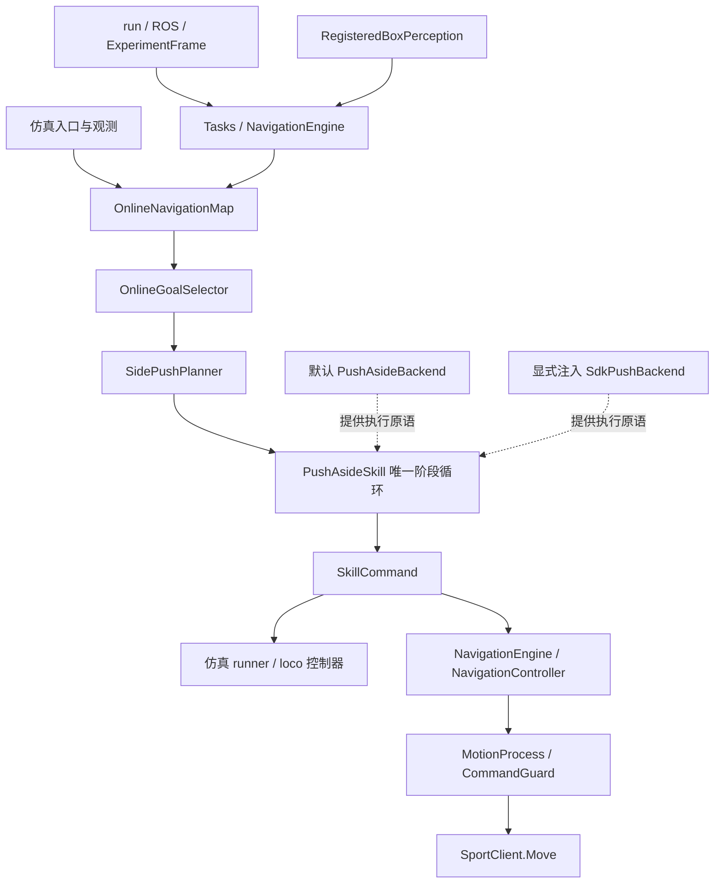

# 项目结构与执行边界

仿真与真机共用导航决策、推箱阶段循环和通道几何证明。观测来源与底层执行分开；仿真策略回读、SDK 请求回执和实测运动是不同的数据，不能互相替代。

## 运行入口

| 目录 / 文件 | 职责 |
|---|---|
| `grutopia/demo/go2_online_interactive_navigation.py` → `go2_side_clearance_navigation.py` | 仿真任务入口；对接 Isaac 观测、机器人控制器和仿真记录 |
| `grutopia_extension/interactive_navigation/` | 共享地图、决策、规划、技能和几何查询；包含原仿真默认执行后端 |
| `deploy/app/` | 真机会话、任务生命周期、导航调度、启停与命令交接 |
| `deploy/perception/` | 当前 LiDAR 的登记箱体跟踪；视觉接口保留为诊断来源 |
| `deploy/interaction/` | SDK 参数、执行后端、接触检查、箱体停稳和回放交接 |
| `deploy/robot/` | ROS/SDK 边界、时间与坐标适配、独立运动 writer |
| `deploy/visualization/`、`deploy/recording/` | 读取同一会话，显示和保存证据；不创建另一套导航决策 |
| `tests/`、`deploy/tests/` | 分别覆盖共享/仿真行为与真机适配；合成输入不作为物理验收 |
| `reproduction/`、`delivery/` | 仿真资产、固定任务复现和历史交付证据 |

## 导航与交互链路

图中实线表示数据与阶段流，虚线表示后端注入；调用调度由仿真 runner 或真机 NavigationEngine 完成。共享模块只依赖通用接口，不导入 deploy，也不按 `sdk` 字符串选择实现。仿真直接构造技能时使用默认后端；真机由 `deploy/interaction/skill_backend.py:create_push_skill()` 注入 SDK 后端。技能和后端只产生动作意图，真机命令统一交给独立 writer。

完整任务仍为：探索/导航 → 比较绕行与推移 → 选择箱体、推向和停放位置 → 接近与对齐 → 推移与退出 → 新扫描确认整机通道 → 恢复原目标并停稳。

## 模块之间的约定

| 边界 | 传递内容 | 接收方负责 |
|---|---|---|
| Sensors → Tasks | `Snapshot`：规划坐标中的点云、机器人位姿/速度与原始采集时刻 | 检查新鲜度；同一周期的感知结果只消费一次 |
| Perception → NavigationEngine | 完整 `BoxState`、登记权限、关联代次、源扫描时间与 ID | 当前几何与地图可见性共同决定能否交互 |
| Planner → Skill | 箱体、推向、推距和任务起终点 | 推进唯一阶段循环，不直接改动物体或机器人位姿 |
| Skill → Backend | 当前上下文、控制目标与阶段需求 | 根据对应执行系统生成原语和测量依据，不另建状态机 |
| Engine → Controller → Writer | 机身速度、执行代次、源观测期限和绝对预算 | 最终限速、超时、接管和停稳；请求回执不等于物理成功 |
| Skill → Navigation | 新扫描支持的通道证书 | 完成停稳交接后才能继续决策，不能提前开启下一次推箱 |

耗时规划在 writer 停稳后执行。等待期间只更新观测和地图。技能若在这段无输出期间完成，使用该次匹配的停稳确认交接，不先重新启用再停止。控制周期预算仅用于决定是否提前停稳；真实观测截止时间与 writer 的硬截止独立执行。

SDK 的平移与转向停止响应分别配置。接近、转向、恢复中的扫掠检查覆盖相应停止响应；接触阶段还独立检查未被目标图层擦除的实测点云及箱体停止空间。

## 仿真隔离与验证范围

- 默认技能配置字段及原控制器保持兼容；未注入后端时不读取 SDK 参数。
- planner 的 `body_geometry`、`motion_backend` 是实例属性，不改模块全局状态。
- 在线地图的原默认自身过滤宽度仍为 `0.44 m`；真机实测包络由 deploy 子类提供。
- 箱体源时间、接触预算、带噪停稳判定属于 deploy，不能改变仿真的默认判据。
- 仿真默认路径、跨实例隔离、真实感知接入、失效停止和 writer 协议分别测试。

代码对照和离线回归验证输入相同时的算法行为，不能证明不同物理环境的轨迹一致。真机完整复现仍需要实测机器人/箱体几何、全过程跟踪可见性、SDK 响应及现场验收；当前默认未开启推移。Isaac 的完整物理效果按 [仿真复现入口](README.md#4-执行任务) 验证，真机按 [推箱操作与验收](deploy/docs/interaction.md) 验证。

SDK 后端的具体接口与文件分工见 [interaction 模块说明](deploy/interaction/README.md)。
