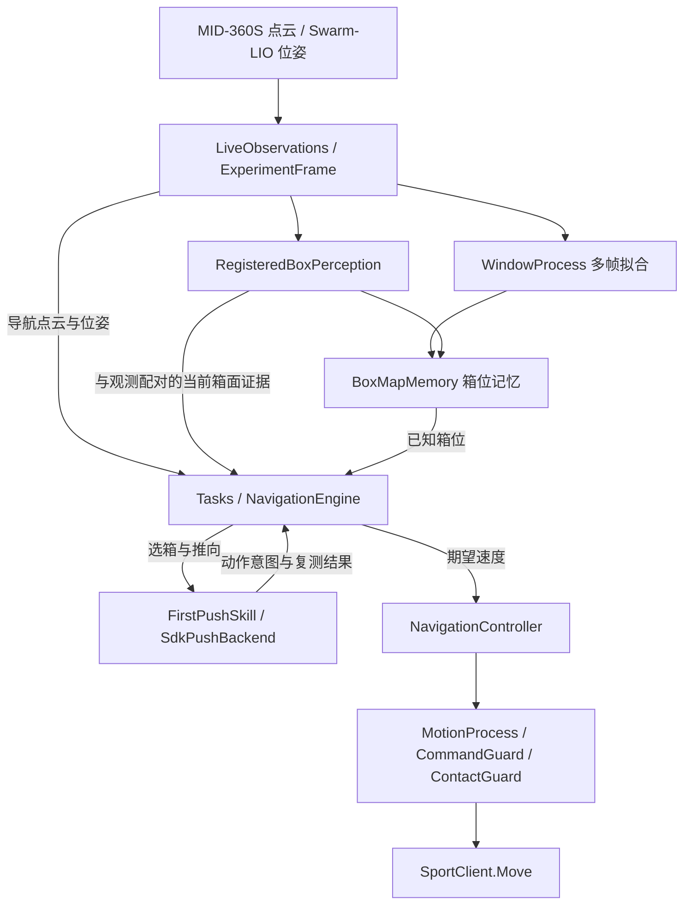

# 项目结构与执行边界

仿真与真机共用导航决策、推箱阶段循环和通道几何证明。观测来源与底层执行分开；仿真策略回读、SDK 请求回执和实测运动是不同的数据，不能互相替代。

## 运行入口

| 目录 / 文件 | 职责 |
|---|---|
| `grutopia/demo/go2_online_interactive_navigation.py` → `go2_side_clearance_navigation.py` | 仿真任务入口；对接 Isaac 观测、机器人控制器和仿真记录 |
| `grutopia_extension/interactive_navigation/` | 共享地图、决策、规划、技能和几何查询；包含原仿真默认执行后端 |
| `deploy/app/` | 真机会话、任务生命周期、导航调度、启停与命令交接 |
| `deploy/app/observations.py` | 独立观测线程：坐标适配、持续跟踪、原始观测发布；向导航交付固定的一对观测与证据 |
| `deploy/perception/` | MID-360S 单帧箱面复核、多帧拟合与本轮箱位记忆 |
| `deploy/interaction/` | SDK 参数、执行后端、接触检查、箱体停稳和回放交接 |
| `deploy/robot/` | ROS/SDK 边界、时间与坐标适配、独立运动 writer |
| `deploy/visualization/`、`deploy/recording/` | 读取同一会话，显示和保存证据；不创建另一套导航决策 |
| `tests/`、`deploy/tests/` | 分别覆盖共享/仿真行为与真机适配；合成输入不作为物理验收 |
| `reproduction/`、`delivery/` | 仿真资产、固定任务复现和历史交付证据 |

## 真机从观测到运动

`deploy/run.py` 加载配置并选择真机、诊断或回放入口。真机由 `run_live()` 组装模块。默认配置只做点导航。现场箱体配置 `box_30x80x30.yaml` 启用首次短推，`--box-window` 另外启用多帧认箱。下图以这组现场配置为例。

多帧点云让稀疏的箱面逐渐清楚，`Session` 把有效箱位写入 `BoxMapMemory`，供地图显示和接近规划使用。接触前，`RegisteredBoxPerception` 用当前扫描复核箱体身份与箱面。普通 `view.py` 和 `record.py` 从同一个 `Session` 读取地图、观测和事件。离线回放复用 `Tasks`，通过录制的机身运动反馈判断停稳。

| 模式 | 规划与执行 | 完成依据 |
|---|---|---|
| 默认点导航 | `NavigationEngine` 调用共享地图、`OnlineGoalSelector` 和路径跟踪器，选择直达、绕行或探索 | 到达输入目标并停稳 |
| 首次短推 | 对已知的可推箱，`RegisteredFacePlanner` 优先寻找可达且有刹停空间的箱面。地图箱位可引导接近。当前扫描确认后，由 `FirstPushSkill` 复用共享技能的对齐和接触动作 | 沿推向约 10 cm 请求停车。停稳后，新扫描测得沿推向至少 2 cm、横移小于 3.5 cm，且本次未因偏离推向而停，才记为成功并对原目标重新规划 |
| 完整推箱 | 使用实测接触参数，由共享规划器比较绕行与侧推。`PushAsideSkill` 调用 `SdkPushBackend` 执行接近、推移和退出 | 新扫描确认整机通道，运动端确认停稳后，导航继续前往原目标 |

仿真通过同一共享技能调用默认后端，输出交给仿真控制器。真机通过 `create_push_skill()` 选择首次短推或完整技能，两者的运动命令最终都经过 `MotionProcess`。[技能工厂](deploy/interaction/skill_backend.py)

## 模块之间的约定

| 边界 | 传递内容 | 接收方负责 |
|---|---|---|
| Sensors → Tasks | `Snapshot`：规划坐标中的点云、机器人位姿/速度与原始采集时刻 | 检查新鲜度；同一周期的感知结果只消费一次 |
| Perception → NavigationEngine | 完整 `BoxState`、登记权限、关联代次、源扫描时间与 ID | 当前几何与地图可见性共同决定能否交互 |
| Planner → Skill | 箱体、推向、推距和任务起终点 | 按所选技能推进阶段，返回动作意图 |
| Skill → Backend | 当前上下文、控制目标与阶段需求 | 根据对应执行系统生成原语和测量依据，不另建状态机 |
| Engine → Controller → Writer | 机身速度、执行代次、源观测期限和绝对预算 | 最终限速、超时、接管和停稳；请求回执不等于物理成功 |
| Skill → Navigation | 首次短推给出停后位移，完整推箱给出通道证书 | 完成相应的停稳交接和复核，再决定下一段路线 |

耗时规划在 writer 停稳后执行。观测线程持续采集和更新箱体身份，原始观测以采集频率发布；它不访问地图、技能或运动 writer。导航每轮读取固定的 Snapshot 与箱体证据，后台更新不能改写正在计算的证据；开始/恢复任务通过代次重置，旧代次的拟合结果不能重新出现。地图和技能仍由导航主线程独占，恢复运动前必须用新观测重新检查。

显示最多约 5 Hz，观测线程在每帧点云到达时处理，记录的原始观测独立于渲染，包含平均 10 Hz 的采集帧及每次决策实际使用的帧；导航决策平均 10 Hz，并从到期后新到的点云开始，命令有效期不再被固定轮询的等待时间消耗。原始观测、显示帧、事件分别有游标和缺失计数；不会通过重打时间戳或补帧掩盖缺失。历史显示降频记录仍可读取，但不能补回当时未保存的观测。

技能若在无输出期间完成，使用该次匹配的停稳确认交接，不先重新启用再停止。控制周期预算仅用于决定是否提前停稳；真实观测截止时间与 writer 的硬截止独立执行。

SDK 的平移与转向停止响应分别配置。接近、转向、恢复中的扫掠检查覆盖相应停止响应；接触阶段还独立检查未被目标图层擦除的实测点云及箱体停止空间。

## 真机推箱的排查顺序

1. 先查 `box_window_result`。地图上的箱位和长边方向用于选择接近位置。
2. 查 `decision` 是否选中推箱。从记忆箱位接近时，`box_face_aligned` 记录转正，`box_face_confirmed` 记录转正后新扫描确认了箱面。已有当前扫描许可时，导航器可直接启动技能，对齐和推路检查在技能内完成。
3. 查 `push_speed_sent`，确认运动端实际发出了第一条顶箱速度。停车后查 `first_push_result` 的停止原因和实测位移。与现场箱底标记对照，再看原导航目标的 `task_result`。

## 仿真隔离与验证范围

- 默认技能配置字段及原控制器保持兼容；未注入后端时不读取 SDK 参数。
- planner 的 `body_geometry`、`motion_backend` 是实例属性，不改模块全局状态。
- 在线地图的原默认自身过滤宽度仍为 `0.44 m`；真机实测包络由 deploy 子类提供。
- 箱体源时间、接触预算、带噪停稳判定属于 deploy，不能改变仿真的默认判据。
- 仿真默认路径、跨实例隔离、真实感知接入、失效停止和 writer 协议分别测试。

代码对照和离线回归验证输入相同时的算法行为，不能证明不同物理环境的轨迹一致。真机完整复现仍需要实测机器人/箱体几何、全过程跟踪可见性、SDK 响应及现场验收；当前默认未开启推移。Isaac 的完整物理效果按 [仿真复现入口](README.md#4-执行任务) 验证，真机按 [推箱操作与验收](deploy/docs/interaction.md) 验证。

SDK 后端的具体接口与文件分工见 [interaction 模块说明](deploy/interaction/README.md)。
