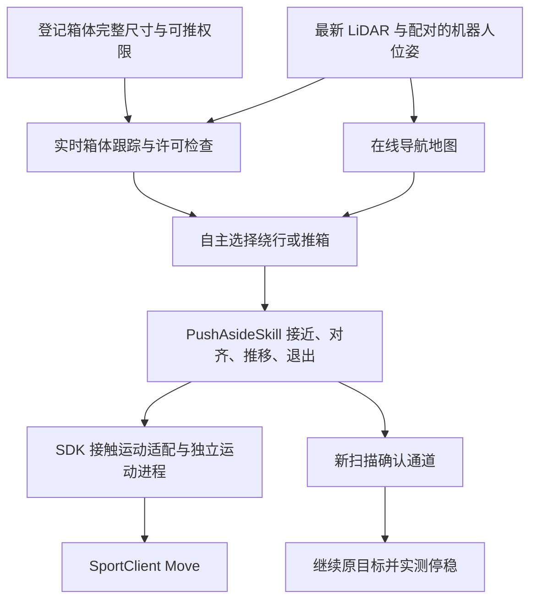

# Go2 真机自主推箱与导航方案

目标是在真机上复现当前仿真的完整行为：输入导航目标，机器人自主探索或行进；遇到登记过的挡路箱体时，自行比较绕行和推移，选择接近位置、推向及停放位置，推动箱体让出通道，退出接触，以新扫描确认通道，再继续到达原目标并停稳。

本文保留实验设计与验收口径。登记箱体跟踪、非语义权限、完整技能的 SDK 后端及独立执行守卫现已接入，配置与操作见 [真机推箱交互](interaction.md)。默认仍关闭推移，实际几何与 SDK 参数须现场测量，真机完整效果尚待验收。短推只作为控制标定，不作为最终交付结果；本方案不依赖语义识别服务。

## 1. 实现路线

保留 `OnlineGoalSelector → SidePushPlanner → PushAsideSkill → 通道确认 → 导航`，补齐真实观测与执行接口。真机继续用现有 SportClient 速度接口，MCF 保持运行，不在这次工作中替换底层运动策略。



首个验收场景使用一个已登记的轻质、刚性、尺寸可测的箱体，放在平地通道中；侧边有足够停放、对齐与退出空间。箱体移动，其他环境物体保持静止。箱体尺寸、重量、摩擦、通道宽度以现场测量记录为准，不沿用仿真数值。

实验前登记箱体、核对传感器和场地，属于准备工作。正式运行中不人工指定推移方向、不遥控接近或推箱；机器人自动完成上述全过程。发生接管的轮次记录为中止，不计为自主成功。

## 2. 当前代码已经有什么

| 部分 | 当前实现 | 现场需要验证 |
|---|---|---|
| 导航与交互决策 | 复用在线地图、绕行/推箱选择、侧向停放规划 | 布局确实需要推移，所选停放位置和通道可用 |
| 完整推箱技能 | 同一个 `PushAsideSkill` 调用 deploy 注入的 SDK 执行后端 | 实测几何、速度响应和带载停止距离 |
| 箱体感知 | 登记完整尺寸，当前 LiDAR 拟合实时位姿；RGB-D 保留诊断用途 | 接近、接触和退出全过程的可观测性与误差 |
| 非语义许可 | `registered_box_lidar` 绑定登记摘要、关联代次和新鲜几何 | 身份歧义、丢失和重新关联时正确停止 |
| 点云与坐标 | `/utlidar/cloud_deskewed` 进入统一 experiment 坐标，保留扫描来源时间 | 绝对距离、自运动补偿、地面参考和时间配对 |
| RGB | SDK 预览默认 2 fps，仅供人工观察 | 不作为接触位姿或精确采集时间证据 |
| 真机运动 | 独立 `MotionProcess` 调用 `SportClient.Move`，执行 TTL、接触预算和停稳交接 | SDK/遥控共存、实际停止、断流及超预算处理 |
| 记录与显示 | 同一会话提供箱体包络、阶段、跟踪质量、年龄和通道结果 | 录制内容与现场视频、标尺测量一致 |

仿真探索与推箱共用一个仿真 loco；真机探索与推箱则共用 SportClient 对接的机器人运动服务。两端的实际步态和接触响应不是同一套可假定等效的实现。SDK 的请求成功返回不等于机器人已经执行，也不证明箱体受到预期接触。[官方 SportClient 接口](https://github.com/unitreerobotics/unitree_sdk2_python/blob/master/unitree_sdk2py/go2/sport/sport_client.py)

## 3. 用真实观测替代仿真箱体状态

### 3.1 登记尺寸和权限，实时测量位姿

新增箱体登记表，保存 `id`、实测长宽高、允许交互的技能、测量来源及本轮关联信息。它替代仿真中已知的物体类别和可推属性，不提供预先已知的导航地图或预设推移轨迹。

首次关联可在实验准备阶段由操作者确认唯一候选。运行中的箱体选择、推向和停放位置由规划器决定。身份不明确时不把许可自动转移给最近的点云簇。

跟踪器输入是最新扫描及其配对位姿，不使用 view 中累计的历史点云。拟合已知尺寸长方体的可见表面、边缘与朝向，输出完整箱体包络；机器人移动时利用同一观测时刻的位姿统一坐标。

| 输出字段 | 要求 |
|---|---|
| `object_id / session_id / planning_frame` | 本轮唯一身份；坐标系或会话变化后原关联失效 |
| `center_xyz / orientation / local_dimensions` | 位姿来自实时观测，完整尺寸来自实测登记 |
| 保守规划包络 | 从完整尺寸和当前姿态计算，并加入观测误差余量 |
| `source_stamp / captured_at / scan_id` | 保留原始扫描标识和时间映射，不用处理完成时间续期 |
| `visible_faces / fit_residual / pose_uncertainty` | 区分实际观测到的约束和模型补全，不能只输出一个置信分数 |
| `valid / invalid_reason` | 包含遮挡、几何欠约束、身份歧义、过期和坐标不连续等状态 |

适配现有 `BoxState` 时应明确：规划包络与 `local_dimensions + orientation` 是不同表示；使用世界轴对齐包络时不再重复施加箱体 yaw。底部应与已核验的地面参考一致，翻倒或明显变形的箱体不再按直立长方体执行。

只看到一块没有边界的平面时，无法确定沿平面的箱体中心。即使尺寸已知，也不能把缺少的位姿当作已测量。需要边缘、相邻侧面或其他经过验证的独立约束。接触近距也必须持续满足可观测性；丢失时停止，不靠命令积分或最后一次位置继续推。

### 3.2 先确认 LiDAR 在整个动作中的可观测性

第一项数据实验覆盖：机器人静止而箱体移动、箱体静止而机器人移动，以及从接近到接触再退出的视角变化。必须验证能把机器人自身运动与箱体移动区分开。

之前的静止墙面记录中，话题原点墙距约 95 cm 与人工测量 78 cm 的差异尚未解释。这不能直接换成一个全局 `-17 cm` 修正量。需要用同一物理基准核验箱面到机器人实际接触部位的距离，并在多个位置、朝向复测；误差超出接触几何余量时不得进入接触阶段。

如果 LiDAR 在实际推箱距离必然失去足够约束，就在这一步调整感知方案：采用已标定、具有可核验采集时间的标记相机，或调整传感器布局。标记位姿估计需要相机内参和标记实际尺寸；用于本方案还要标定 camera→base、tag→box，验证时序、遮挡与位姿歧义。[AprilTag 官方姿态估计说明](https://github.com/AprilRobotics/apriltag#pose-estimation)

现有 RGB 预览不能直接满足这些条件。可选标记不会替代未通过的时间和几何校验；LiDAR 与标记结果冲突时也不能任选一路继续动作。

### 3.3 权限与观测分开

`registered_box_lidar` 来源以登记文件和本轮唯一几何关联证明“这个箱体允许推”，持续的实测几何证明“现在可以对它执行接触动作”。许可绑定箱体 ID、登记文件摘要和本轮关联代次。

几何过期、重定位跳变、身份切换或接管后，当前执行许可失效；恢复前重新核验身份、现场几何和任务状态。登记尺寸可以保留，旧位姿和旧接触预算不继承。

配置校验、provider 创建、导航许可检查和共享技能使用同一来源契约。RGB-D 可见 AABB 尚不满足完整接触几何要求，只保留诊断能力；登记来源不包装成两帧 Qwen 分类，真机也不接受 `ground_truth_layout`。

## 4. 保留完整技能，替换仿真相关执行假设

技能仍执行：准备停放方案 → 接近待推位置 → 停稳与对齐 → 接触推动 → 制动 → 退出接触 → 重新观测 → 通道确认。箱体停放目标和推距由当前地图决定，最终效果不限定为 10–20 cm 小推。

`policy_command=None` 表示 SDK 没有仿真策略内部反馈。deploy 工厂显式注入 SDK 执行后端，由它使用实际位姿、速度和停稳反馈推进；共享状态机不判断设备类型，仿真默认后端保留原有策略反馈与控制方式。

| 项目 | 实现方式 |
|---|---|
| 机器人接触几何 | 规划、地图过滤和接触检查共用实测 nose、头部和足部包络 |
| 运动后端能力 | 显式区分 simulation/sdk；SDK 回执与实际运动反馈分别记录 |
| 对齐与转向 | 根据实测位移、朝向和停稳推进；SDK 不使用依赖 45D 策略回执的脉冲或仿真起步弧线 |
| 推移与刹停 | 使用 profile 中实测速度、加速度、停止响应及余量 |
| 退让与恢复 | 配置中的实际退速生效，检查正退、侧退和实测运动的制动扫掠 |
| 统一限制 | 接近、对齐、推移、退让、恢复共用真机 profile，独立 writer 再次限制 |

同一 `PushAsideSkill` 通过 `PushAsideBackend` 接口调用接触控制、朝向微调和退让原语。默认后端调用原仿真控制器；`deploy/interaction/skill_backend.py` 的 SDK 后端负责真机响应与传感器证据，实测 profile 不进入共享层。

SDK profile 需要实测的字段包括正向/反向/侧向最小有效速度、角速度响应、速度与加速度上限、空载/带载停止距离、各阶段姿态和偏差界限、无进展时限、最长接触时间及有限重试预算。初始标定值不是最终通行能力证明；不能通过不断升速或延长顶住时间弥补箱体不动。

现有技能没有接触力闭环。接触与推动效果由几何、箱体实测位移、机身速度/姿态共同判断，不能把电机电流或 SDK 返回码直接解释为准确接触力。

## 5. 地图、接触与实时性

- 普通导航继续使用障碍和未知区约束。进入指定箱体的接触阶段后，只允许已登记目标的预期接触面发生受控接触；不能把整个箱体附近的墙面或其他障碍一起屏蔽。
- 每次推移命令都检查机器人请求轨迹、实测惯性轨迹、箱体扫过区域和可用停止空间。独立接触检查保留未被目标图层擦除的原始点云证据，目标以外的障碍及未知区域仍有效。
- 箱体移动后的旧占据不能由“预计推到了”直接擦除。更新目标模型，同时等待新的自由空间观测确认原区域；看不到的区域保留未知或阻塞。仅对登记目标建模，不引入全场动态物体自动清除。
- 通道成功条件保留：目标箱体实际移动并侧停、机器人退出接触、箱体停止移动后的新扫描、当前全局路线和整机局部通道检查。截图看起来空了不能代替通道证书。
- 昂贵检测/拟合采用独立工作线程或进程及有限队列；主循环只消费最新有效结果。初次全局规划仍在运动启用前完成，不通过后台重发旧非零命令掩盖规划停顿。
- 命令有效期取原有 TTL、机器人反馈有效期、点云有效期和目标几何有效期的最早截止时间。当前 0.35 s TTL 不因交互放宽；处理完成或收到重复帧不能刷新源观测时间。
- 独立 writer 按交互执行代次锁定速度限制与绝对截止时间。整个技能预算从选择目标开始，接触预算从首次接触阶段开始；重试或停稳规划不续期。预算到期、父进程失联或遥控接管后锁止，不自动重发旧命令恢复。

感知精度与速度一起确定接触余量：至少计入测距/拟合误差、坐标配对误差、观测延迟期间的相对运动以及停止距离。仅凭“10 Hz”或平均误差合格不能证明近距离接触可用；需要记录实际帧龄和误差尾部，并据此限制运动。

## 6. 实施顺序与验证

各阶段服务于同一个完整交付目标，不将前置标定当作最终 demo。

| 阶段 | 工作与产物 | 进入下一阶段的条件 |
|---|---|---|
| A：观测数据与几何 | 登记实际箱体；采集箱动/狗动/接触距离视角三组数据；输出位姿、尺寸、可见面、误差与失效原因 | 全过程可观测；绝对接触几何和时序有误差界限；遮挡、歧义和断流不产生有效跟踪 |
| B：跟踪与权限接入 | 新 provider、登记来源、完整 `BoxState`；离线回放和在线只观察模式 | 自动匹配目标，持续跟踪；未知物体不得推；权限不跨身份/会话继承 |
| C：完整链路离线验证 | 同一规划器和技能使用假 SDK/录制输入，覆盖正常阶段与故障分支 | 验证决策、状态转换、预算、清障与交接；明确回放无法验证新的动作造成的物理结果 |
| D：SDK 接触参数标定 | 空载速度/转向/停稳，带载短推和退出，形成 profile | 有效速度、停止距离、目标移动、遮挡处理和接管均有实际记录；短推仅属于此阶段 |
| E：完整自动运行 | 只输入导航目标，自动接近、对齐、推开、退出、重扫、穿过、到达 | 满足下一节整体验收，运行过程中无人工运动干预 |

建议先在一个箱体上完成整条链路，再在保持框架不变的情况下增加箱体和不同起始朝向。若 A 阶段确认现有传感器无法在接触全过程观测，应先解决观测源；调推箱增益不能补出缺失的箱体状态。

### 数据采集动作

机器人静止时，在地面标尺上人工把箱体平移约 10、25、40 cm，并转动约 15°；每次记录实际值，分别停留数秒。然后保持箱体静止，用原生遥控器让机器人缓慢前后移动、转向，覆盖拟定接近距离和箱体侧面视角。最后检查贴近与退出时哪些面会消失。

这三组数据不需要程序自动推箱。它们用于验证：箱体位姿是否持续更新、自运动补偿是否正确、接触全过程是否可观测。此前的静止墙面 bag 不包含移动箱体，不能替代此验证。

## 7. 完整 demo 的验收口径

首个场景应实测确认：箱体挡住预定通道，侧边确实能停放，推开后整机可通过。登记只提供尺寸、身份和许可，不提供最终停车坐标或现成路线。

| 验收项 | 证据与判据 |
|---|---|
| 自主决策 | 记录绕行与推移比较、选定箱体、推向、目标停放区域；正式轮次只输入导航目标 |
| 实际推移 | 独立现场视频/地面标尺与跟踪记录一致；箱体实际位移超过 0.25 m，并达到此次规划所需的让路效果；机器人自身移动不能代替箱体移动 |
| 安全退出 | 未接触非目标障碍；箱体未翻倒，机器人无跌倒；退出接触后有新鲜停稳反馈 |
| 通道形成 | 箱体最终移动后的新扫描支持全局路线和整机局部走廊，误差余量计入通道检查 |
| 通过与到达 | 机器人整机通过原阻塞位置，继续原目标，误差小于当前配置的 0.25 m 且实测停稳 |
| 故障处理 | 目标丢失、过期、身份歧义、超预算、卡滞与人工接管均停止/锁止，不以自动重试冒充成功 |
| 可重复 | 同一布局建议连续 3 次完整成功；再改变起始朝向重复。分别记录失败和中止，不挑选成功片段代替统计 |

固定物体、未登记箱体和不明确目标应选择绕行、继续观测或停止，不授予推移权限。推箱发生与否由任务和路径代价决定；“没有推”不必然是错误，但要求推箱的验收布局必须完成物理推移与通过。

## 8. 运行与记录安排

沿用进入 deploy 后运行的方式。以下是数据采集命令；启用新跟踪 provider 和完整交互模式前应按 [操作文档](interaction.md) 填写实测登记与 profile，不能仅将 `interaction_enabled` 改成 true。

终端 1：保持只观察，人工移动箱体或使用原生遥控器采集数据。

```bash
source ~/unitree_ros2/setup.sh
cd ~/inter-nav-project/deploy
source ../.venv-deploy/bin/activate
python run.py --observe-only
```

终端 2：保存 deploy 实际使用的观测与地图。

```bash
cd ~/inter-nav-project/deploy
source ../.venv-deploy/bin/activate
python record.py --output ~/go2-interaction-records
```

原始 LiDAR、IMU、odom 同步录包的方法见 [sensor_check.md](sensor_check.md)。复用其中录包命令与 QoS；本文的观测采集需要同时保留 observe-only run，不套用该文“退出 run 后做纯传感器测试”的步骤。记录实际箱体尺寸、标尺位移、朝向、接触部位、源码版本和上游驱动启动方式。

需要核对 SDK/遥控响应时，在另一个终端保存只读控制数据；它不包含点云，不能替代上面的记录。

```bash
source ~/unitree_ros2/setup.sh
cd ~/inter-nav-project/deploy
source ../.venv-deploy/bin/activate
python record.py --control --duration 120 --output ~/go2-interaction-control
```

保持原有操作：`python run.py`，`n` 输入目标；`p` 暂停、空格取消、`q` 退出。交互配置应显式选择已经验收的 provider/profile。view 显示箱体规划包络、观测年龄、拟合质量和当前阶段；record 保存跟踪诊断及原始观测、请求/实际速度、停止原因和通道证书。

## 9. 代码落点与离线验证

| 位置 | 职责 |
|---|---|
| `deploy/perception/` | 登记箱体与 LiDAR 已知几何跟踪器、独立质量/时序检查、回放入口 |
| `deploy/app/config.py`、`runtime.py`、`tasks.py` | 区分语义 RGB-D 和登记箱体 provider，保留统一观测流 |
| `deploy/app/navigation.py` | 新许可来源、完整目标位姿、交互阶段预算与交接事件 |
| 共享 `push_aside_skill.py`、`push_aside_backend.py` | 唯一技能状态机、执行扩展接口和原仿真默认后端 |
| 接触与全身几何检查模块 | 同步使用同一实测包络；全部动作检查非目标障碍与停止空间 |
| `deploy/interaction/` | SDK 参数与控制后端、真实箱体停稳、执行代次、原始点云接触检查和回放交接 |
| `deploy/robot/contact_guard.py`、`motion.py`、`safety.py` | writer 侧阶段限制、接触时间预算、目标观测截止时间，不绕过现有 TTL/接管 |
| `deploy/visualization/`、`recording/` | 位姿和阶段显示，跟踪及权限来源、时间、结果证据记录 |

离线测试覆盖几何拟合、单面连续跟踪、身份与权限、规划器选择绕行或推移、SDK 参数、接触扫掠、writer 截止时间、停稳规划和回放交接。共享技能测试同时检查默认仿真行为。测试输入与假 SDK 可以验证代码契约，无法证明新命令带来的物理结果；最终验收始终是第 7 节的完整自动交互导航。
