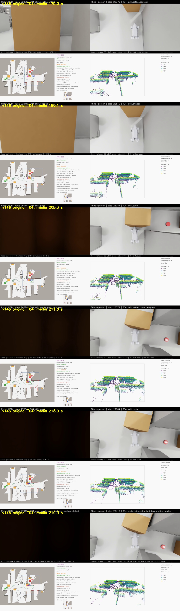

# 最后一次部分推箱后的撤离与效果确认

更新：2026-10-30。**v147原始T04已完整验收通过，T05正在同版测试。** 运行源码为`fdaf2aa22f3e1cae34079761184e67cb3d8807eb`。最新视频、实际穿越和停稳证据见[原始T04结果](go2_original_t04_v147.md)。下方保留v146失败诊断及本次收尾修改说明。

## 已完成的v146原始T04

从[2.11,-0.78]到[10.3,1.75]，原尺寸Go2/MV7、1cm地面、空地图在线建图。B06实际向西侧移0.670403m，但补推停止进展，耗尽重试后直接结束；失败原因为`push_aside:retry_limit:box_motion_stalled`。最终目标误差1.337322m，27150主步，全物理步最大倾角27.931620°。未超过30°不等于任务完成；未获得清路证书，也未实际穿越。

五路完整视频各5485帧、25fps、219.40秒。录像解码、55份运行源码、原始坐标、在线空地图、无瞬移和本地SHA256校验通过；任务和实际穿越检查为false。T05按前置验收门控未启动。

Windows总览：`E:/inter-nav-results/go2-online-smooth-20261027/recognition-skill-v146-t04-ground-truth-try1/T04/video/combined.mp4`，其余四路在同目录。

## 为什么还不能只归因于policy

两次接近过程中触发18°接触姿态保护，第三次真正推动箱子。另将控制轨迹与逐物理步接触日志按完全一致的实际位置对齐：两次失稳触发点前后各50个物理步（各0.25秒）只有地面接触，没有箱子或其他障碍接触；接触回调无错误。首次B06接触出现在之后的第三次接近，由Head_lower接触B06。因此前两次波动不能归因于碰撞箱子，也不能仅凭这点将原因全部归于权重；速度组合、步态响应和部署仍需区分。见[接触时序证据](data/go2_contact_onset_review_v146.json)。底层启停/短转响应仍有不足，上层最后一次尝试的收尾也有独立缺陷：之前的重试允许制动、撤离和新观测后的效果确认，最后一次却在重试计数超限时直接失败，跳过这条路径。

保存在线地图的只读检查发现一条完整机身候选通路，且原箱子位置会阻挡这条通路。但机器人当前机身占据仍与障碍缓冲区重叠，简单向后移动的候选位置也未通过检查；静态几何恢复搜索未找到完整安全出口。因此这份检查仅用于定位问题，**不证明能够物理撤离，更不证明任务成功**。v147必须实际完成撤离、新观测确认、穿越和原目标停稳。

已测的NVIDIA Isaac Lab rough候选在相同部署下初始静止倾角18.693°，不满足15°启动要求，短转回退也更大，未采用。当前rough7850是第三方权重；核查的宇树官方RL Gym/RL Lab公开版本有Go2训练/部署代码，但未附带可直接使用的Go2预训练权重，不能把NVIDIA或第三方模型称为宇树出厂policy。固定来源、接口及部署版本限制见[官方方案核查](go2_official_policy_review.md)，短指令数据见[policy对照](go2_contact_preparation_settling.md#参考policy对照)。

## v147修改与验证

最后一次尝试失败时，如果本次skill确实建立过接触且有超过原有效果入口0.25m的实测侧移，则先进入原制动/撤离流程。它不会重新就位或再发起推箱。撤离后的0.4秒实测停稳、箱子可见性、晚于运动的新观测、完整机身通路、当前和原始起点到目标的全局连接、原箱子反事实阻挡等检查保持原样。

只有原有完整效果证书成立才能结束交互；之后仍需实际穿越及到原目标0.25m内停稳。撤离后没有证书、再次恢复失败或超过已有时间/健康限制，任务仍失败。`max_retries=4`、原始0.85m名义推箱计划、18°接触保护与30°全程健康线均未放宽。

新增回归首先复现7项失败，修复后全套721项通过，1项既有G1相机检查未运行。测试覆盖最终部分推箱的制动、禁止新增推箱尝试、完整地图证书、新观测/可见性/原障碍必要性，以及30°硬限制；这些是控制和几何回归，不是动力学成功记录。

v147从原始T04坐标完整运行，使用独立固定源码工作树、相同GPU物理和原rough权重；T04完整验收通过后才启动原始T05。资源仍为24GiB硬上限、零swap、56GiB准入及共享串行锁。五路录像保持25fps。

证据：[运行、测试和冻结地图诊断](data/go2_final_push_release_v147.json)。运行入口与参数见[README](../README.md)；v145近箱诊断仍不能替代原始任务。
