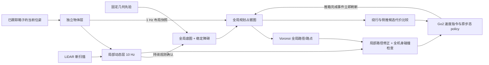

# Go2 交互导航：分层地图、交互收益与闭环验证

本轮目标是在原尺寸 MV7、1 cm 辅助地面中，让 T04/T05 通过侧推箱子打开通路后真正到达原来的红色目标点。旧 v19 两组均未完成，因此不作为成功基线。

## 地图与控制数据流

- **固定底图**来自已有场景碰撞先验，保存只读副本与哈希。墙体、家具不会因为某个箱子移开或局部观测过期而被擦掉。
- **全局规划图**以约 1 Hz 更新箱子布局快照。持续被 LiDAR 观测 3 s 的未跟踪障碍可进入稳定补充层；连续自由观测 1 s 可移除补充层中的旧证据。固定底图始终受保护。
- **全局路线与局部包络分开**：全局 Voronoi 使用 0.30 m 圆形通行余量，并对低净空骨架边增加代价，让路线可以绕过窄缝并在途中转向。局部控制按狗的实际 yaw 检查长矩形脚部包络和平移/旋转扫掠。将固定朝向的长矩形用于整张全局图会错误限制可转向的路线；本场景的人形障碍上方宽路因此需要这种分工。
- **局部动态图**以约 10 Hz 更新机器人周围 6 m × 6 m 窗口。用当前扫描的 hit/free 射线更新，临时障碍证据保留 1.2 s；过期仅移除临时层，底图和已跟踪箱子仍参与碰撞判断。
- **机器人自身回波处理**沿用原探索中的足迹清除原则，覆盖当前有朝向包络及栅格误差余量；只移除临时传感器证据，固定底图、已确认稳定障碍和箱子层受保护。输入点云先过滤相应的自身回波，避免机器人在地图中留下会被误当成障碍的拖影。
- **箱子是独立物体层**。位姿变化时先计算旧占据与新占据，腾空区域只去掉该物体留下的动态证据，保留重叠箱子和墙体。LiDAR 在箱体边缘 4 cm 内的回波用于物体关联，不重复沉积成静态障碍。
- **事件触发更新**：清障成功、退出接触后重新规划等时机立即刷新全局布局，不等待下一个周期。控制层使用最新局部图，必要时按实际位姿重规划。
- **局部接回全局路点**使用实际包络约束下的局部 A*，目标是沿既有全局路线前进约 1 m 内的锚点，保留后面的全局路径。局部搜索限制在滚动窗口和全局路线走廊中，避免重新选到障碍另一侧的窄缝。恢复动作也检查整个身体沿途的碰撞，而不只检查中心线。
- **可视化使用同一地图**，不会再显示一张不参与导航的旧累积占据图。历史点云中已经腾空的箱子区域也会清理，当前扫描的新证据仍保留。

目前箱子身份、尺寸和位姿由仿真提供；这不是已经实现了真实环境中的箱子语义识别。该接口以后可以替换为视觉/激光目标跟踪器。

## 为什么交互，以及收益怎么计算

每次决策同时计算：

1. 保持箱子现状的可行路径和长度。
2. 假设移开挡路箱子后的同起点、同终点路径。
3. 机器人到推箱接触位置的路径、侧推距离、释放后的剩余路径。
4. 停车位置与路径是否碰撞，是否为通路侧面停车，是否留出了机器人通行宽度。

当前选用的代价是米等效量：

`交互代价 = 接近距离 + 2.5 × 推动距离 + 释放后的剩余导航距离`

它用于和不交互的绕行距离比较，不应解释成真实耗时。两条完整路径都存在时显示节省的路径长度；交互前不可达而交互后可达时显示“恢复连通”，不会把无穷大路径差伪装成有限距离收益。

地图中显示箱子编号、推箱方向、预测停车位置、不交互路径、清障后预测路径、当前执行路径、代价分解和地图版本。局部地图 inset 显示实际用于碰撞检查的高频图。金色为当前箱子，红色为临时局部障碍，绿色为刚腾空的区域。

每次运行将预测路线长度、推动距离、代价和可达性变化写入 `events.jsonl`。这些是候选规划结果，必须由物理复跑验证；实际行驶距离会受局部避障、接触和重新对齐影响。候选距离使用同一个全局碰撞图评估，执行的 Voronoi 路径另有净空偏好。

## 到达与控制修正

T04 原来在转向漂移后，直接横移对准门中心。现在清障与转向后，从机器人的实际位姿重新规划到终点，由全局路径和局部碰撞图引导穿门。

T05 原来会在鼻端距箱面不足 0.10 m 时横移对齐，而前脚约比鼻端向前多 0.17 m。现在任何横向/旋转对齐前至少需要 0.26 m 鼻端间距；退让按实际间距结束，并检查目标箱子之外的障碍。局部导航和转向检查采用前方 0.50 m、后方 0.32 m、半宽 0.22 m 的脚部包络。机身脱离障碍后释放朝向恢复状态，恢复动作不会再被定时重规划反复重置。

对“当前位置可以站立，但不能朝下一段路径转身”的拐角，控制器在局部地图搜索可转向的暂驻位置，检查移动过程和完整转向扫掠。先用后退/侧移到达转向空间，再转到全局路径引导的方向，然后恢复普通跟随。该恢复过程不缩小机器人、不关闭碰撞，也不修改 locomotion policy。搜索失败或超时会明确请求重规划。

成功仍需原始起终点、真实步态与接触物理：机器人体进入终点范围、完整机身穿门、停稳后误差小于 0.25 m，并通过高度/倾角检查。校准起点、预测移箱图、程序正常退出或视频正常保存都不能代替这一判定。

高度和倾角在每个环境 tick 检查，包括对齐、退让和终点停稳的内部等待循环。暂停期间发生的失稳不会因为随后重新站稳而被忽略；`rollout_health` 保存最大倾角、最低高度和第一次违规位置。

## 第三视角

相机降低到机身上方 1.35 m，继续 90°俯视、狗头朝上并随实际 yaw 转动。旧吊灯遮挡点的低视角预览已看到完整机身。正式录制再向前移 0.25 m、采用 100°水平视场，以更好地同时观察机器人和箱子的接触面；仍需对正式任务抽帧检查。场景物体的物理属性保持原设置。

## 当前验证状态

自动测试为 297 passed、1 deselected。未运行的 G1 测试依赖本 Go2 分支不包含的配置文件。v7/v8 在原始 T04 桌椅拐角处未完成，已中止；v9 从 `(5.8, 0.63)` 出发的局部物理校准通过原卡点，到达 B06 前后因退让检查失败终止，箱子未移动。随后加入接触换向前停稳、基于局部几何的退让方向选择，v10 正在箱前校准。以上均不等于原始任务成功。

完整任务结果仍在验证，暂不宣称全部成功。正式验证使用原始起终点，每组单独初始化仿真进程，同时只加载一个完整材质场景。结果保存在服务器 `/data20t/embodied/zkj/inter-nav-results/go2-dynamic-interaction-20261026`，下载目标为本机 `E:\inter-nav-results\go2-dynamic-interaction-20261026`。
