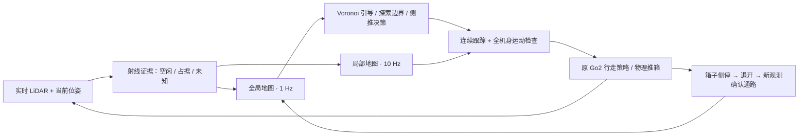

# Go2 在线地图与连续导航

## 地图来源

任务开始时全局、局部占据栅格的已观测数均为 0。已知信息只有地图分配边界和请求的任务坐标；
仿真当然加载场景用于物理和传感器生成，但规划器不读取场景碰撞网格、建筑元数据或门口表。
箱子检测暂用仿真提供的候选身份、尺寸和位姿，通过当前真实 LiDAR 命中数门控后入图。
机器人定位仍使用仿真位姿，不是同时估计位姿的 SLAM。

- 5 cm 栅格；全局 1 Hz，局部 10 Hz、机器人周围 6 × 6 m。
- 结构占据累积 LiDAR log-odds，箱子占据保存在独立对象层。
- 箱子移走后旧占据先变为未知，新自由射线确认后才供规划使用。
- 全局 Voronoi 路线仅走已观测中心点；局部检查完整机器人足迹和实际速度的运动范围。
- 目标尚不可达时选择已观测区域内可达的探索边界。只有存在可执行目标方案时才结束该探索段；
  “假设箱子不存在时可达”不再触发每秒重复改路。

## 传感器证据

旧融合只保留障碍高度范围内的命中射线，空旷通路中的量程终点和地面回波被丢弃，形成未知条带。
在线模式改用 0.5° 水平 / 2.5° 垂直采样，并使用真实射线与栅格的交点：

1. 障碍命中保留为占据。
2. 无命中的量程终点只提供到 99% 最大量程的自由证据，不成为三维点云表面。
3. 地面/高处回波只清除射线位于障碍高度范围内的部分。
4. 同方位较近的已测障碍截断其他高度的自由射线，遮挡后方保持未知。

在保存的 T04 初始密集点云上，旧规则观测 2,560 格，新规则观测 4,362 格，
新增 1,804 个自由格；两种处理得到的障碍命中完全一致。少数原先仅由高处射线经过的格子
因高度裁剪恢复未知，所以总观测增量略小于新增自由格数。这是离线同帧对照，不是导航成功率。

## 速度控制

保留原探索的 `rough_model_7850.pt` 和 50 Hz 策略推理。在线模式默认使用
`--actuator-mode explicit_dc`：每个 5 ms 物理步重新计算 DC 电机力矩，匹配训练中的
PD 增益及力矩随转速饱和的约束。关闭隐式驱动并读取实际增益确认，避免两套驱动叠加。
物理步长固定为 5 ms，每 8 个物理步录制一帧（25 fps）；渲染不再让控制间隔变成 20 ms。
`--actuator-mode implicit_pd` 保留用于旧结果对照。逻辑导航节拍仍平均 125 Hz，
因此 `--max-steps 30000` 对应最多约 240 秒主任务仿真时间，另加初始化、停稳与确认阶段。
连续路径跟踪直接复用 `MapNavigationRuntime.velocity_action_for` 的速度律，正常前进上限
0.50 m/s、侧向上限 0.18 m/s、前视距离 0.55 m。跨路径更新保留速度状态，
按实际仿真时间限制线加速度 0.65 m/s²、角加速度 1.8 rad/s²。
新障碍进入制动范围时仍允许紧急停止；推箱接触和目标停稳阶段独立处理。

恒速诊断中请求 0.50 m/s 时实际前进中位数约 0.481 m/s；低速、转向和接触状态的响应不同。
因此不能把视频中的每次停顿都解释成 policy 跟踪差，也不能仅靠降低所有速度解决。
已发现并修复的上层问题包括重复零指令、重复目标切换、遗漏自由射线导致的反复观察。
地面厚度对照没有证明加厚能消除静止转向迟滞，正式场景仍保留原 1 cm 地板。

旧隐式驱动下另一个已实测的问题是停稳后的纯转向低响应：匹配地面和复位条件的诊断中，
请求 `(vx, vy, wz)=(0,0,1)` 时角速度中位数约 0.214 rad/s，
`(-0.20,0,1)` 的短后退转弯则约为 0.912 rad/s。整段恒定后退转弯试验最高倾角
21.324°、中位倾角 4.177°；这是动作诊断数据，不是导航任务结果。

转弯控制现在监测实际朝向进展，超过 0.8 秒缺少进展时才尝试短转弯弧线。
候选动作和加速度限制后的动作都必须通过已观测地图的全机身检查；停靠转弯保持有效弧线
直到预测制动或平移达到 0.20 m。转弯前的停靠位置也要求容纳该动作，避免只验证
“原地旋转几何可行”，却让当前步态无法启动。一般探索平移仍用原速度律。
停靠末段保持至少 0.20 m/s 的步态请求，再按实测平移速度提前制动；不再渐近下降到
无法移动的极小请求。新发现箱子引起重规划时，先检查当前路线上的下一条速度指令，
避免无条件插入一个零速脉冲。

固定物理步长的独立转向对照中，同一 `(0,0,1)` 指令的实测角速度中位数从约
0.214 增至 0.510 rad/s。该对照只验证控制响应，不代表所有转弯或交互都已成功。

箱前大角度转向复用导航的已观测空间转向准备流程，逐步检查整个机身以及实测漂移的
制动距离；原先只在进入对准阶段前检查一次，随后纯 yaw 请求的横向漂移仍可能撞墙。
候选位移必须位于已观测空闲区，接触前包括目标箱子在内的所有箱子都参与碰撞检查。
箱前对准的制动距离按当前实际纠偏轴计算：横向对准只看横向剩余距离，前后对准只看前后距离。
模式切换先等待实测速度降低，避免前后误差掩盖侧向制动距离、造成来回越过中心线。
连续控制模式的箱前平移按剩余误差和滤波后的实测速度减速，侧向也遵守
`--contact-centering-speed` 上限，并检查限制加速度后的动作和实测制动空间。
此前默认 0.35 m/s 的横移在剩余几厘米时会多次越过中心线。

导航恢复转向现在保持已选中的目标朝向，不因下一帧突然出现后退候选就取消。
每帧仍检查已有碰撞重叠只能减小；新障碍使转向失效时先制动观察，再重新选择。
T05 失败轨迹最后 10 秒曾有 97 次转向/平移切换、位移仅约 1 mm，说明这些指令没有形成有效步态。

## 侧停、退让与通路确认

箱子达到实际侧停安全余量后停止推力，随后退开并确认通路；不再因为自身遮挡导致通路尚未
观测齐全而继续推一个已经到位的箱子。如果完整退让段尚未知，只执行经全机身检查的已观测
短段，并继续采样。箱子既有接触只能减少，不能借此穿过未知或其他障碍。

退开后会等待最多 3 秒新观测，重新检查全局连接与局部全机身通路。若点规划器的一条穿门线
过于贴墙，还会检查名义通路附近的候选线；候选必须同时满足原安全距离、局部全机身扫掠，
以及任务起点和当前机器人到通路两端、目标的全局连接。不会通过减小膨胀或清除墙体取得证书。

实测失败地图中，一条穿门线贴到了右墙的 5 个栅格；改用已观测中央通路后，保持 0.52 m
机身通路宽度和 0.04 m 机身余量，检查 69 个位姿，仍有约 0.10 m 侧向余量且两端连通。
这是同一保存地图的几何回归验证，完整物理任务仍需要实跑确认。

## 输出与复核

运行命令见 [README](../README.md#go2-在线建图规划与交互导航)。每组输出：

- `initial_unknown/layered_map.npz`：首帧之前的空地图。
- `layered_map.npz`：实际在线观测、全局/局部占据和对象层。
- `events.jsonl`：探索目标、路线、交互原因和预测路径收益。
- `control_trace.jsonl`：指令、策略锁存指令、实际速度、位姿、倾角所需姿态和已观测格数。
- `result.json`：原目标误差、完整过程健康检查、推箱次数和地图来源。
- `video/combined.mp4`：启用录像时的完整任务视频；正上方视角随狗朝向旋转。
- 输出根目录 `source_manifest.json` 与 `source/`：本次运行所用源码快照。

## 验证状态

代码检查点 `cb91e07`，403 项自动测试通过，1 项依赖缺失的人形测试未运行。
五组统一物理与录像验收尚未完成。

| 在线批次 | 已确认结果 | 尚未解决或等待验证 |
| --- | --- | --- |
| `full-online-v19` / 隐式驱动 | T01、T02、T03 到达原目标，完整录像逐帧检查通过 | T04、T05 导航中失稳，均未完成侧推 |
| `online-v21-rest` / 固定物理步长 DC | T01、T03 到点，误差 0.197 m、0.076 m，峰值倾角 14.77°、17.01° | T02、T05 失稳 |
| `online-v21-T04` / 固定物理步长 DC | 全程未超过健康阈值 | 箱前转向漂移接触墙面，撤退受阻；箱子未移动 |
| `online-v22-T02` | 到点，误差 0.151 m、峰值倾角 26.89° | 有 4 次姿态恢复，仍不能称为全程平顺 |
| `online-v22-T04` | 箱前转向完成 | 后续横向对准超时，箱子未移动 |
| `full-online-v22` / `dd1f211` | T01 完整录像验收通过，误差 0.201 m、峰值倾角 14.77° | T03 局部绕行中失稳，峰值 45.73° |
| `online-v23-T05` / `78eeaf7` | 实际侧推 0.648 m，新扫描确认两端连通的完整机身通路 | 随后恢复动作切换导致超时，距目标 0.981 m |
| `online-v24-T04` / `e3973a8` | 箱前平移改进正在原始任务中复测 | 未完成 |
| `full-online-v25` / `cb91e07` | 已启动 T03、T02、T05 完整材质录像 | 未完成 |

已验证的新 DC 录像索引：本机 `E:\inter-nav-results\go2-online-smooth-20261027\ONLINE_VIDEO_STATUS.md`。
当前只有 T01：`full-online-v22/T01/video/combined.mp4`，五路各 727 帧、25 fps、29.08 秒，
逐帧解码、仿真时长、黑帧及移动时重复帧检查通过；源码 36 文件哈希及本地下载哈希一致。
侧向足迹从 0.22 m 增至 0.26 m 的 T02 候选在窄弯停滞，已作为失败诊断终止，没有采用为默认。

T03 失败速度序列在空地的两种固定 5 ms 控制回放均未超过 30°，峰值分别约 20.32°（DC）
和 19.60°（隐式 PD）。两组使用相同的 2,617 个物理步指令，但清空了原场景障碍，
复位朝向使用起终点方位角而不是原任务固定的 90°，因此不能据此宣称精确复现或定位了原场景失稳原因。

T01 的正常导航阶段实测速度中位数约 0.409 m/s，请求为 0.50 m/s，零速请求占比为 0。
探索阶段仍包含观察和安全制动。T01 两次运行的峰值倾角从 28.06° 降到 14.77°，
但这是不同闭环轨迹的结果，不能替代同一指令序列的转向对照或五组完整验收。
`push_count` 目前计数进入交互准备的次数，不证明箱子实际移动；实际移动和通路清理以
`side_push_end` 事件、箱子轨迹、通路证书及最终目标误差为准。

T02/T04 诊断显式开启 `--navigation-attitude-recovery`，在 18° 倾角时请求原策略停稳后重规划，
30° 失败阈值保持不变。是否适合作为默认配置需依据此次完整轨迹，不能靠增加停顿宣称步态变顺。
产物根目录：`/data20t/embodied/zkj/inter-nav-results/go2-online-smooth-20261027`。
较早使用已知地图的成功视频不能替代当前版本的在线录像验收。
