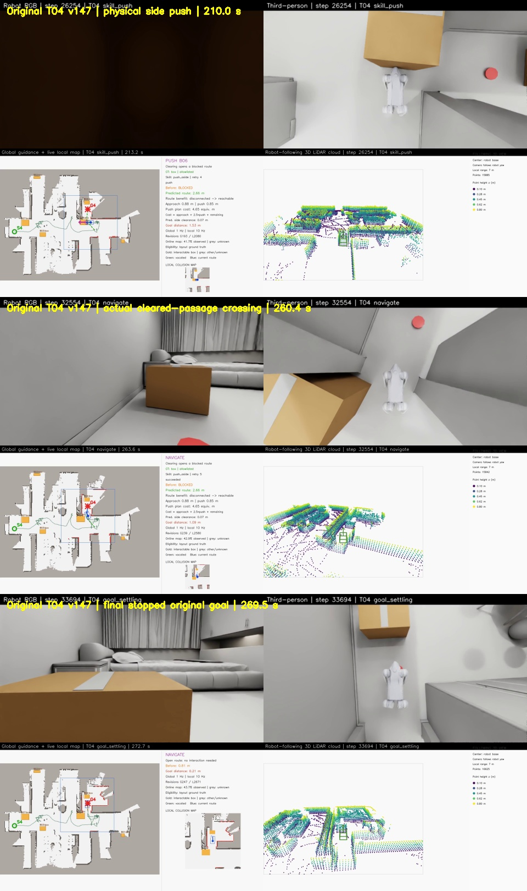

# v147原始T04完整验收通过

更新：2026-10-30。**本页v147原始T04完整通过，但整体任务尚未统一完成。** v149 T05仍在对准阶段失败，当前候选状态见[最新诊断](go2_yaw_step_diagnostics.md)。本页运行源码为`fdaf2aa22f3e1cae34079761184e67cb3d8807eb`，该成功记录不能替代后续版本的T04回归。

## 原始任务结果

| 检查项 | 实际结果 |
|---|---|
| 起点 → 目标 | [2.11,-0.78] → [10.3,1.75]，无起点覆盖 |
| 机器人与场景 | 原尺寸Go2、原尺寸MV7，辅助地面顶面0.01m |
| 侧推 | B06向西实际移动0.670848m，名义计划0.85m |
| 最终停稳误差 | 0.212162m，0.4秒实测停稳检查通过 |
| 全物理步最大倾角 | 27.931620°，53934个健康检查采样，无30°违规 |
| 主控制步 | 33330 |
| 地图 | 初始未知，无场景先验读取，全局/局部1/10Hz |
| 五路录像 | 各6741帧、25fps、269.64秒 |
| 校验 | 任务、实际穿越、视频、55份源码及本地视频SHA256全部通过 |

这次保留了原rough7850权重、19刚体/15.019kg训练模型、GPU物理与显式DC电机控制。较大角度转向候选`70ed99f`单独保存在服务器，未用于本次成功记录。本轮仍有6次导航姿态保护恢复，动作平顺性还有改进空间。

## 真实清路与穿越证据

补推停滞后进入最后一次制动/撤离收尾，未再发起新的推箱尝试。机器人实际恢复出接触占据区，并在230.610s的新观测上确认通路；该观测晚于箱子最后运动224.810s。确认同时要求当前全局连通、完整局部机身通路和“原箱子会阻挡此通路”的反事实检查，因此实际侧移小于名义计划仍可按原有完整效果规则结束交互。

独立穿越审计保留并拒绝了224.800s的一次早期越界，因为当时机身仍未清除与箱子的占据重叠。后续机器人回到通路入口并实测停稳，再于263.550s完成有效的连续穿越；运动前后的箱子观测稳定，实际箱位不阻挡机身，原箱位会阻挡同一机身通路。最终原目标误差和停稳另行检查通过。

已实际解码检查上述画面。近距离推箱时第一视角被箱体遮挡，第三视角和地图仍显示接触过程；穿越和最终停稳画面的场景正常。没有用近箱起点诊断替代原始任务。

## 视频与复现

Windows总览：`E:/inter-nav-results/go2-online-smooth-20261027/recognition-skill-v147-t04-ground-truth-try1/T04/video/combined.mp4`。

同目录还有`robot_rgb.mp4`、`third_person.mp4`、`map_topdown.mp4`、`pointcloud_map.mp4`。五路本地文件均与服务器SHA256一致。

服务器结果：`/data20t/embodied/zkj/inter-nav-results/go2-online-smooth-20261027/recognition-skill-v147-t04-ground-truth-try1`。

复现入口和完整参数见[README](../README.md)，最后一次接触撤离的修改见[实现说明](go2_final_push_release.md)，完整证据见[结果和审计数据](data/go2_original_t04_v147.json)。随后T05因子导航访问状态问题失败，当前复跑状态见[最新说明](go2_subnavigation_lifecycle.md)。
