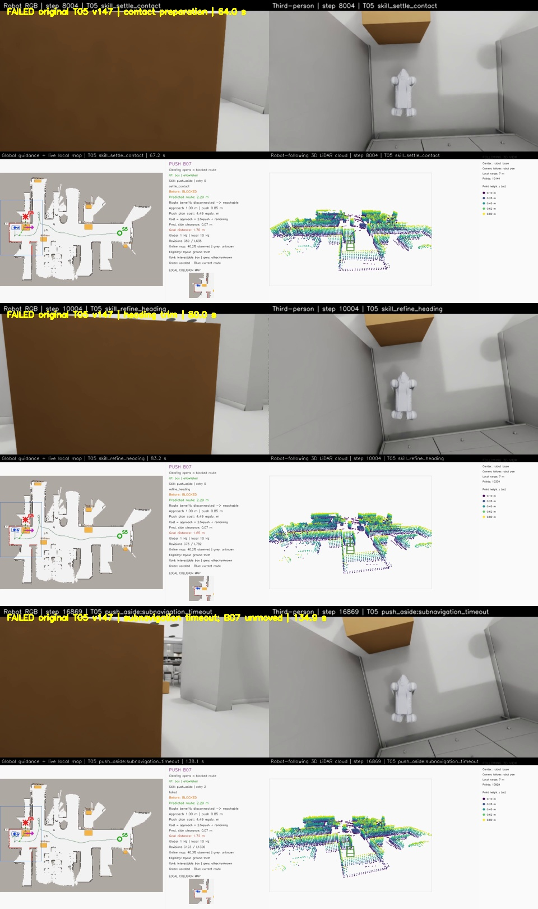

# 子导航重访同一目标时重置访问状态

更新：2026-10-30。**原始任务仍未统一完成：v149 T05侧推0.123m后在对准阶段失败，当前验证有界短转候选。** 最新证据和状态见[转向诊断](go2_yaw_step_diagnostics.md)。下方保留本页对应版本的实现与历史验证。

## v147 T05的实际失败

原始起点[13.6,-0.4]、目标[3.3,1.4]。B07没有有效位移；两次朝向微调超时后，第三次进入就位子导航约0.01秒就报`subnavigation_timeout`，整轮失败原因为`push_aside:subnavigation_timeout`。16601主步，最终目标误差1.724296m，记录最大倾角18.918°。健康检查通过不等于推箱或导航任务完成。

五路视频各3376帧、25fps、135.04秒，解码、55份源码及本地SHA256全部有效；任务与实际穿越检查为false。Windows总览：`E:/inter-nav-results/go2-online-smooth-20261027/recognition-skill-v147-t05-ground-truth-try1/T05/video/combined.mp4`。

## 原因与修改

子导航之前只在目标坐标变化超过0.02m时重置计时。skill离开子导航去转向、横向对准、停稳或恢复时，旧目标、旧路径控制器、到达制动状态和计时起点仍保留。后续重访同一个就位目标，会把中间非导航动作的时间也计入原来的80秒限制，甚至在新一轮刚开始时立即失败。

现在，当skill不再输出导航目标时，结束该次子导航，清理这四项访问状态。机器人姿态、地图、policy和速度渐变器不被重置；侧向对准等当前skill动作照常执行。下次即使目标坐标相同，也从新的一次访问开始。连续导航仍保持80秒限制，微小目标抖动不会刷新预算；全skill的180秒、4次重试、30°健康线和0.25m目标门限均保持原样。

测试直接执行生产脚本中的子导航函数和skill分派分支，并使用真实到达检查器验证状态生命周期；将测试机器人置于子目标处，以隔离计时与状态问题，不将这些测试当作物理运动验证。新增用例先复现2项失败，修复后全套726项通过，1项既有G1相机检查未运行。检查同时覆盖同目标重访、路径与到达状态清理、保留当前skill速度、连续80秒限制、坐标抖动和目标副本。

本次改动是子导航访问状态的结束处理。两次朝向微调中的短转/停稳循环也已保留为诊断数据；微调响应及实际推箱成功仍需在新一轮物理运行中验证。

## 当前复跑

v149固定同一候选源码，先运行原始T05，全部服务器验收通过后再运行原始T04。使用原rough7850、19刚体训练模型、GPU物理、原尺寸场景、1cm地面、空地图与1/10Hz在线更新、Voronoi引导、真值箱子资格及LiDAR可见性门控、五路25fps录像。仍使用24GiB硬上限、零swap、56GiB准入和共享串行锁。

v147原始T04的完整成功记录继续保留，见[原始T04证据](go2_original_t04_v147.md)；它不能替代新版本T04回归。完整失败记录、回归结果和新任务启动信息见[证据数据](data/go2_subnavigation_lifecycle_v149.json)。运行入口见[README](../README.md)。
