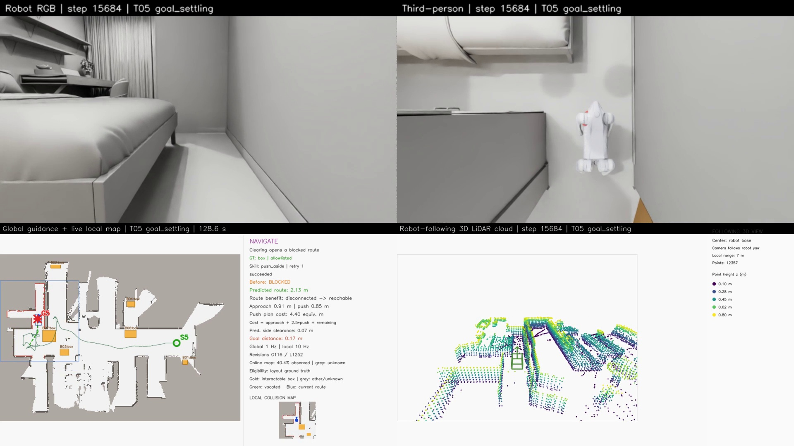

# 支撑关节目标保持与恢复行走（v127候选）

## 原始 T05 v127 已完整通过；同版 T04 失败

使用固定源码 `648ecf46fd703557bf7d720ab773f18e76c9229e`、旧rough+匹配训练模型+显式支撑目标保持+原18°恢复层，原始T05 `[13.6,-0.4] → [3.3,1.4]` 已完成。B07沿侧推方向实际移动 **0.836079 m**，新观测确认通路后机器人实际穿越，最终停稳误差 **0.173951 m**。全物理步最大倾角 **21.712124°**，15306主控制步、25096健康采样无违规。全任务轨迹约24.55m，包含在线探索、就位和恢复，不能把预测清路后2.13m当成全程长度。

任务/地图/视频、实际穿越与最终停稳、54份源码、实际模型和新增保持行为检查全部通过。保持捕获5次、恢复4次；没有在禁止的接触阶段捕获保持，保持期间关节目标固定且actor继续50Hz，初始释放无目标跳变。证据见 [T05完整验收](data/go2_t05_accepted_v127.json)；`tools/audit_stationary_hold_trace.py <输出目录>/T05` 可复查新增保持行为，不能替代原任务/地图/视频审计。

五路MP4各 **3137帧 / 25fps / 125.48秒**，本地与服务器哈希逐个一致，保留全部探索、恢复、交互及最终停稳。任务录像从初始化站立后的地图预热开始，不包含初始化复位。

- Windows总览：`E:/inter-nav-results/go2-online-smooth-20261027/recognition-skill-v127-t05-ground-truth-try1/T05/video/combined.mp4`
- 服务器：`/data20t/embodied/zkj/inter-nav-results/go2-online-smooth-20261027/recognition-skill-v127-t05-ground-truth-try1/T05/video/`
- 其他四路在同目录：`robot_rgb.mp4`、`third_person.mp4`、`map_topdown.mp4`、`pointcloud_map.mp4`。



同版T04已回归失败：B06推箱前转向达到37.904°，箱子未被推开。历史T04 v119的通过结果继续保留，不能把它冒充本版本的回归结果。进一步的策略/物理后端对照见 [最新诊断](go2_policy_physics_diagnosis.md)。下方为此前候选设计与诊断记录。


原 rough policy 在某些转向后的零速等待中会继续改变关节目标并失稳。v124的隔离实验表明，确认完整停稳后保持已有支撑目标，可以避免其中两个案例的后续站立漂移。当前把这一机制做成显式开关，尚待原始T05/T04完整场景验收。

## 控制行为

`--stationary-joint-hold` 默认关闭，且要求 `explicit_dc`。开关通过配置同时传入直接速度和路径控制器，两者共享同一保持状态。

- 只在允许的自由空间阶段、速度请求为零、身体满足原有完整停稳条件连续0.4秒后，保存当时的12个关节位置目标。
- 保持期间actor仍按50Hz推理；原显式DC电机仍在每个5ms物理步计算25/0.5 PD及23.5Nm、30rad/s力矩速度包络。没有设置刚体位姿/速度、固定关节或修改碰撞体/重力。
- 新运动请求或保持权限关闭后，在0.4秒内从保持目标逐渐混合到当前policy目标。反馈给actor的上一动作对应实际发送的混合/保持目标。恢复完成后正常使用原policy动作历史。
- 推箱接触、推后退出等阶段不允许进入保持；权限变化在下一次actor更新处理。无效/失去支撑的状态不能新进入保持。原有30°健康线继续独立执行。
- 使用正式导航已有的18°触发姿态恢复，恢复后从实测位置重新规划。保持机制不替代该恢复层。

`robot_model_contract.json`记录实际启用状态；`recording_config.json`、每步`control_trace.jsonl`和任务结果记录保持/释放状态及次数。新运行保存54份源码快照，补齐了Go2资产解析器和新保持模块。

## 检查与实际范围

686项回归检查通过，1项既有G1相机检查未运行。检查包含完整停稳捕获、无初始关节目标跳变、混合到实时actor目标、接触权限、复位/时钟回退、双控制器配置一致性，以及保持时50Hz推理和200Hz电机更新、实际动作历史。

v125的裸就位诊断未带上导航姿态恢复层：普通恢复行走通过，另一方向在保持已释放后的持续转向中超过30°。v126使用同一个正式18°恢复层、同一30°失败标准重新对照，结果如下：

| 配置/案例 | 就位、恢复行走、最终停稳 | 行走距离 | 最大倾角 |
|---|---|---:|---:|
| 无保持，普通恢复 | 失败，零速等待中失稳 | 0 m | 30.359° |
| 无保持，权限案例 | 通过 | 0.848 m | 22.104° |
| 开启保持，普通恢复 | 通过 | 0.859 m | 15.121° |
| 开启保持，权限案例 | 通过（使用两次既有姿态恢复） | 0.839 m | 29.129° |

这是平地物理+保存在线几何约束的诊断；权限案例在空地检查接触状态的控制开关，不能冒充真实推箱成功。最后静止观察10秒。原始T05/T04仍必须验证实际箱子接触、在线地图清路、真实穿越和原始目标停稳。数据：[v125](data/go2_supported_hold_integration_v125.json)、[v126](data/go2_supported_hold_integration_v126.json)、[模型合同](data/go2_supported_hold_model_v126.json)、[v125转向诊断](data/go2_supported_hold_turn_diagnosis_v125.json)。

## 使用

在 [模型匹配与策略对照](go2_training_policy_candidate.md) 的旧rough+匹配训练资产配置中追加 `--stationary-joint-hold`，保留 `--actuator-mode explicit_dc --navigation-attitude-recovery`。原始场景和任务坐标、地图1/10Hz、1cm地面、25fps录像等参数不变。

正式任务候选入口仍是 `grutopia/demo/go2_online_interactive_navigation.py`。`tools/diagnose_go2_hold_restart.py`仅用于上表的隔离诊断，不是在线导航入口。例如在仓库根目录、Isaac Python环境中：

```bash
"$ISAAC_PYTHON" tools/diagnose_go2_hold_restart.py \
  --gpu 2 --output /path/to/new-diagnostic-output --label with_hold \
  --policy /data20t/embodied/share/inter-nav/assets/robots/go2/policy/move_by_speed/rough_model_7850.pt \
  --robot-asset "$go2_reference/go2_training_flattened.usdc" --command-profile slew
```

变量`go2_reference`及固定哈希下载方式见模型匹配文档。完整场景按24GiB上限/零swap/主机56GiB持续60秒准入，串行运行。先测试T05，只有完整验收通过才回归同版T04。历史T04 v119成功结果继续保留，不当作本版本已经通过。
