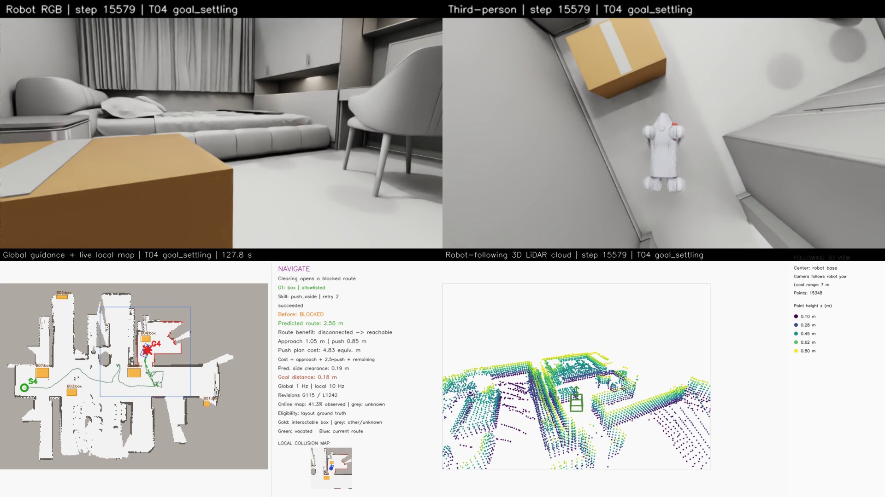

# Go2 模型匹配与策略对照（更新至 v127候选，2026-10-30）

## 最新结果：T05 v127完整验收通过，T04同版回归中

T05实际侧推B07 0.836m、在线确认通路并实际穿越，原始目标停稳误差0.174m，全物理步最大倾角21.712°。54份源码、任务/地图/视频/实际穿越及保持行为检查通过，五路3137帧25fps125.48秒完整视频已本地校验。视频路径和证据见 [T05完整验收](go2_supported_idle_hold.md)。同版T04仍在回归；下方保留此前候选与诊断记录。

## 当前：静止保持已集成，准备原始场景复跑

已将支撑关节目标保持做成 `--stationary-joint-hold` 显式开关：完整停稳0.4秒后保持，收到运动请求或接触权限关闭时0.4秒混合恢复。保持期间actor仍50Hz、电机仍200Hz，实际动作历史保持一致。686项检查通过；带正式18°姿态恢复层的两组物理就位/恢复行走/再次停稳对照均通过，最高倾角29.129°，仍需完整场景。配置、数据和命令见 [支撑目标保持](go2_supported_idle_hold.md)。

先复跑原始T05，通过后回归原始T04；当前没有把历史T04或诊断结果算作新版完整任务通过。下方保留此前诊断和选择依据。

## v122–v124：就位余量一致性修复与静止保持诊断

v121 在原始 T05 第6173步正确消费了 `staging_failed` 并改选探索点，失败反馈修复已在物理运行中触发。但机器人仍停在同一位置：另一个就位控制问题使移动/制动反复切换。该失败前缀已完整保存，10735主步、2202帧、25fps、88.08秒，最大倾角17.315916°；任务未成功，见 [前缀归档](data/go2_t05_failed_prefix_v121.json)。离线重放保存的在线地图也确认能改选 `[2.625,-0.075]`，且没有修改地图数组，见 [重选记录](data/go2_frontier_reselection_v121.json)。

真实地图回放定位到余量不一致：LocalTurnManeuver选中的位置要求0.05m转向余量，而LocalStagingControl始终用0.025m判断是否提前停止平移。实际位置x约4.449m；仅向右变化5mm跨过0.05m地图单元边界，0.025m判断就变为可转，0.05m判断仍不可转。这会在policy尚未形成连续侧移之前触发制动。现在当前位置准入与目标验证均沿用 `selector.stage_margin`，包括原有0.025m窄区域后备方案；不统一扩大/缩小机器人，不改变占据地图。

从真实在线快照提取了测试专用掩码（未知仍阻塞、箱子占据合入，生产导航不读取此测试文件）。两个原本失败的边界测试先复现失败，修复后通过；全套663项检查通过，1项既有G1相机检查未运行。几何数值见 [边界诊断](data/go2_staging_margin_geometry_v122.json)。

短程物理对照使用真实Go2模型和policy、平地物理、保存的地图限制指令；它是控制诊断，不是MV7导航验收：

- v122：旧余量在原探索方向超时，仅移动约1.2mm；修正余量后两个方向均完成就位，但原方向在3秒观察末尾未满足完整停稳条件。
- v123：延长零速观察到8秒后，原方向在后续静止阶段超过30°（30.359°）。就位完成时身体速度已经很小，所以不能只把问题归为就位交接过早。
- v124：在完整实测停稳0.4秒后，实验性地保持当时支持身体的关节位置目标，保持50Hz actor推理和200Hz显式DC电机力矩计算；反馈给actor的上一动作仍对应实际保持目标。两个案例在后续20秒都健康并最终停稳。原方向最大倾角10.122°；另一方向全程28.146°，峰值发生在静止保持前。

完整结果见 [v122](data/go2_staging_diagnostic_v122.json)、[v123](data/go2_staging_diagnostic_v123.json)、[v124](data/go2_staging_diagnostic_v124.json)。验证过的诊断脚本为 `tools/diagnose_go2_staging_idle.py`，参数与下方短测相同（label选择 `selected_margin`）；它使用测试快照，不得当成在线导航入口。

**静止保持目前只在诊断脚本里，尚未接入正式导航，也尚未验证从保持恢复行走。** 下一步需要完成平滑恢复、接触阶段禁用保持等验证，再复跑原始T05和T04。当前正式控制代码只新增就位余量一致性，不能把诊断2/2通过声称为完整任务通过。T04 v119的历史成功结果继续保留。


## v121：T05探索执行失败反馈修复，完整复测待验证

T05 v119 在交互前停滞，没有完成推箱：同一探索点附近20秒内最大位移仅0.013113 m，新增观测单元为0。控制器在转向就位的移动/制动之间切换；LocalStagingControl超时后会报告staging_failed和blocked_ticks=100，但主循环立即局部重规划并用新控制器覆盖tracking，后面的探索失败处理因此看不到失败状态，反复追同一探索点。机器人健康未失败（最大倾角17.315916°），这次问题不能归为policy跌倒。

已主动停止这段无进展运行并保留全部录像，不计为成功：7904主步、1636帧、25fps、65.44秒，五路MP4与服务器哈希一致；任务/通路验收为false。证据见 [T05停滞及归档](data/go2_t05_frontier_stall_v119.json)。

修复在局部重规划之前消费原控制器的终止失败。仅当当前任务段是在线探索点，且存在staging_failed或超过30次阻塞的needs_replan时，记录frontier_execution_failed并将该尝试加入已有观测信息重试机制，保留实际速度历史进行检查过的制动，再由在线选择器选择另一个可执行探索点。普通局部重规划不拒绝探索点，原始任务目标仍优先尝试；不把未知区域标为空闲、不修改碰撞地图。

658项回归通过（1项既有G1相机检查未运行），新增行为检查覆盖：失败后选择其他已观测可达点、地图不被修改、普通重规划不误拒绝，以及原始任务目标不受探索点尝试记录屏蔽。当前先重跑原始T05；T05通过后再回归T04，保持已匹配的旧rough策略/资产、原尺寸场景、1cm地面、1/10Hz地图、30°健康线、0.25m到点及五路25fps录像。T04 v119已通过的历史结果继续保留，下方的c57e86d证据不冒充新修复版本已通过。


## v119：原始 T04 已通过，T05 仍在复测

原始 T04 `[2.11,-0.78] → [10.3,1.75]` 使用旧 rough +匹配训练模型，在固定运行源码 `c57e86dbd6be5bc359fbb6da45afcd6d6ff6bf3d` 下完成：B06 沿侧推方向实际移动 **0.761008 m**，新观测确认通路，机器人实际穿越后到达原始目标，停稳误差 **0.183616 m**。共 **15201** 个主控制步，全部物理步健康记录最大倾角 **29.374338°**、无健康违规。

实际穿越、最后0.4秒停稳、原始坐标、原尺寸和1cm地面、空地图初始化、禁止先验地图读入、无rollout瞬移、技能资格及效果链、52份运行源码快照、五路视频解码等检查均通过。完整证据见 [T04验收记录](data/go2_t04_accepted_v119.json)。

五路视频各 **3116帧 / 25fps / 124.64秒**，本地文件与服务器SHA256逐个一致。保留恢复和停稳过程；起始3.2秒物理初始化发生在任务录像之前。此处“完整”指任务录像从地图预热开始到最终停稳结束，不声称包含初始化复位。视频在：

- Windows：`E:/inter-nav-results/go2-online-smooth-20261027/recognition-skill-v119-t04-ground-truth-try1/T04/video/combined.mp4`
- 服务器：`/data20t/embodied/zkj/inter-nav-results/go2-online-smooth-20261027/recognition-skill-v119-t04-ground-truth-try1/T04/video/`
- 同目录另外四路：`robot_rgb.mp4`、`third_person.mp4`、`map_topdown.mp4`、`pointcloud_map.mp4`。



这次通过不等于行走鲁棒性已完全解决：准备转向时有一次接近29.4°的恢复，通路入口也经过多次制动定位。v120补做六组前进/后退/原地转向对照，均低于30°，但正向转角时三种方式表现不同，前进辅助没有全部满足最后停稳，因此暂不据此将所有后退辅助直接替换为前进。数据见 [转向对照](data/go2_turn_arcs_v120.json)。

T05 使用相同 c57e86d 源码、旧策略+匹配训练模型，仍按24GiB上限、零swap和共享串行锁复测。T04的通过不能代表T05通过，也不能代表五组同一配置统一验收。下面保留策略选择的历史证据。


## 最新结果：v117 启动失败与 v118 长静止对照

NVIDIA rough 在原始 T04/T05 都未通过启动检查，导航没有开始。T04/T05 的启动倾角分别为 16.250° / 16.258°，超过原有 15° 启动界限；模型参数检查均通过。零速静止过程中倾角持续增大，不能把之前仅静止3秒的短测试当成充分验证。此次失败发生在录像器启动前，没有五路任务视频；保留了实际控制轨迹、启动事件、模型与源码检查，不能称作完整任务录像。

补充20秒纯静止对照，同一规范资产、限速和材料：

| 策略 | 最大倾角 | 最低高度 | 健康完成 | 最后实测停稳 |
|---|---:|---:|---|---|
| current_rough_standstill | 4.084° | 0.401 m | True | True |
| nvidia_rough_standstill | 18.948° | 0.347 m | True | False |
| nvidia_flat_standstill | 2.990° | 0.252 m | True | True |

详情见 [静止与启动证据](data/go2_idle_and_startup_v118.json)。长静止脚本没有“从移动转到停止”事件，因此使用完整测量停稳器回放末段数据另行检查，没有把通用脚本的空停止列表当成失败。

当前完整场景候选调整为**旧 rough +匹配训练的机器人模型/物理参数**。v119 已安排原始 T04/T05 串行复测，源码仍固定为 `c57e86dbd6be5bc359fbb6da45afcd6d6ff6bf3d`。启动15°、全程30°、目标0.25m等标准不变。NVIDIA rough 暂不作为通过验证的替代品，原始任务仍未完成。

在 README 的完整命令后追加以下参数即可复现当前候选；这是追加参数，不是独立 shell 命令：

```bash
--policy-path /data20t/embodied/share/inter-nav/assets/robots/go2/policy/move_by_speed/rough_model_7850.pt \
--robot-usd "$go2_reference/go2_training_flattened.usdc" \
--robot-physics-profile isaaclab_training --actuator-mode explicit_dc
```

`go2_reference` 的准备方法见下方。下方 NVIDIA rough 选择说明保留为被完整场景结果修正的历史试验依据。


原始 T04/T05 尚未完成。T05 v108 已把 B07 推开 0.778568 m，并获得在线通路确认，但后续导航失稳，未穿越到点；T04 v109 在接触箱子前失稳。两次最大倾角分别为 39.879° / 42.480°，最终目标误差为 1.529 m / 4.822 m。进程正常退出和局部推箱成功均不代表任务成功。

## 来源和部署差异

旧 `rough_model_7850.pt` 来自第三方 isaac-go2-ros2。宇树公开 RL Gym / RL Lab 仓库的核查见 [官方策略核查](go2_official_policy_review.md)；未在所查公开来源找到可直接使用的 Go2 权重，也没有启动宇树策略训练。

本候选使用 NVIDIA Isaac Lab 发布的 `Isaac-Velocity-Rough-Unitree-Go2-v0` 检查点（235 维输入、12 维动作），不是宇树出厂固件。权重、资产的固定下载地址和 SHA256 见 [来源清单](data/go2_reference_manifest_v117.json)。匹配的训练代码为 Isaac Lab v2.0.0；policy 50 Hz、物理 200 Hz、动作尺度 0.25、显式 PD 25/0.5、DC 饱和力矩 23.5 Nm。

旧部署资产有 39 个刚体，零质量 IMU/radar 在 PhysX 中各变成约 1 kg，实测总质量 17.019 kg；训练资产为 19 个刚体、15.019 kg。训练资产的 27 个碰撞形状、默认世界位姿与原资产逐项匹配，未缩小机器人或删除碰撞体，见 [碰撞几何对比](data/go2_collider_equivalence_v117.json)。旧部署小腿的原生限速为 15.7 rad/s，训练代码则将显式执行器的 30 rad/s 限速写入 PhysX。

显式选择 `isaaclab_training` 配置后，加载检查过的训练资产，设置全部关节原生限速 30 rad/s、刚体线速度上限 1000 m/s / 角速度上限 1000 度/s，并匹配小腿和足部接触材料 0.8/0.6、multiply。地面、箱子和头部材料保持原设置。solver 4/0、关闭自碰撞、原生驱动和关节摩擦为零，本来已正确，不根据初始化前警告改动它们。

资产加载器以前会因文件较小而替换一个合法的引用式 USD；现在先检查实际组合的 Go2 刚体、12 个关节和碰撞几何，合法引用文件优先采用。启动时输出 `robot_model_contract.json`，检查实际引用、哈希、质量、刚体数、碰撞体数、限速、驱动和材料；不匹配直接报错。默认 `legacy` 配置保留历史复现能力。

## 短测试结果与限制

每种配置采用相同的 10 组独立初始化指令，包括前后移动、双向侧移、转向、微调及模式切换。原始健康标准为倾角 <30°、机身高度 ≥0.21 m；最终停稳需连续满足测量条件 0.4 秒。独立案例的复位只用于此诊断，不用于导航 rollout。

| v116：同一训练资产、30 rad/s | 健康完成 | 最终停稳 | 最大倾角 |
|---|---:|---:|---:|
| 旧 rough，旧接触设置 | 9/10 | 6/10 | 30.28° |
| 旧 rough，训练接触设置 | 10/10 | 8/10 | 28.94° |
| NVIDIA rough，训练接触设置 | 10/10 | 7/10 | 20.10° |
| NVIDIA flat，训练接触设置 | 7/10 | 6/10 | 5.34° |

flat 的失败来自机身过低，不能因为倾角小就算通过。NVIDIA rough 候选的倾角余量更大，但最终停稳数量没有超过匹配后的旧 rough；因此仅作为完整场景候选，不宣称全面优于旧策略。旧资产/旧 rough 的 v111 为健康 10/10、最终停稳 4/10，也说明空场短测不等同于原始任务成功。完整数据见 [测试记录](data/go2_policy_benchmarks_v117.json)。v114 两组“training asset”被加载器静默替换，已排除；有效规范资产对照从 v115 开始。

## 获取资产和运行

在仓库根目录、Isaac Python 环境中运行；本工具只下载固定哈希的公开资源，模型二进制不提交到 Git。

```bash
source /data20t/embodied/share/inter-nav/env.sh
export PYTHONPATH="$PWD:$PYTHONPATH"
go2_reference=/data20t/embodied/zkj/inter-nav-results/go2-online-smooth-20261027/official-policy-review-20261030/nvidia_isaaclab_4_5
"$ISAAC_PYTHON" tools/prepare_isaaclab_go2_reference.py --output "$go2_reference"
```

在 [README 的完整在线导航命令](../README.md#go2-在线建图规划与交互导航) 中追加以下参数（任务选择 `--task-ids T04` 或 `T05`），其余参数保持一致：

```bash
--policy-path "$go2_reference/rough_checkpoint.pt" \
--robot-usd "$go2_reference/go2_training_flattened.usdc" \
--robot-physics-profile isaaclab_training --actuator-mode explicit_dc
```

上述三行是追加参数，不是独立 shell 命令。短测试的可复用入口如下；`--case-ids forward_stop,mode_switches` 可缩短为集成烟测，省略则运行十组。

```bash
"$ISAAC_PYTHON" tools/benchmark_go2_locomotion.py \
  --gpu 1 --output /path/to/new-diagnostic-output --label nvidia-rough-training \
  --policy "$go2_reference/rough_checkpoint.pt" \
  --robot-asset "$go2_reference/go2_training_flattened.usdc" \
  --physics-profile isaaclab_training --command-profile slew
```

完整场景以固定提交的独立 worktree 串行运行：24 GiB 上限、零 swap、主机可用内存 ≥56 GiB 持续 60 秒后准入。诊断为 8 GiB 上限和 40 GiB 准入。原始 Go2/MV7 尺寸、1 cm 地面、原始目标、空地图初始化、1/10 Hz 地图、Voronoi、可见性约束的箱子真值和五路 25 fps 全程视频不变。验收必须同时满足实际推箱清路、重新观测通路、实际穿越、目标误差 ≤0.25 m、全物理步倾角 <30°、最终停稳及视频/源码审计。

## 集成检查

v117 正式代码回归 654 项通过，1 项既有 G1 相机测试未运行。真实 SDK 烟测检查通过：原生模型合同有效，前进启停与动作切换两组均健康完成且最终停稳；数值重现此前同配置的基准测试。证据：[初始化参数](data/go2_integration_v117_robot_model_contract.json)、[两组短测](data/go2_integration_v117_summary.json)。此记录不是 MV7 全任务验收。
