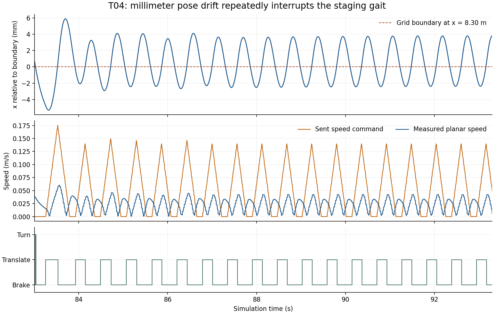

# Go2转向就位的栅格边界切换

最新完整场景状态：v140 T04因受阻拐角停滞结束，T05未启动；v142正在验证前视范围内的拐角准备。见 [最新结果与代码](go2_blocked_corner_lookahead.md)。

更新：2026-10-30。**v139的四组物理对照通过；v140原始T04/T05尚未完整验收。** 历史T05 v127成功和v137 T04失败前缀均保留。

## 实际失败前缀

固定源码`5db0af14da9abdfe4e5f77b171b280b6b95c1465`、原rough7850、GPU物理、无额外关节目标保持，完成15827主步后主动结束已确认的停滞。机器人穿过中部通路，但停在约`[8.30,0.77]`，未推箱，原目标误差2.233084m。最后20秒最大位移仅0.004753m，新增观测单元为0。结束原因是`stop_requested`，不是任务成功。

全物理步最大倾角29.876701°，未违反30°阈值，但余量仅约0.12°，不能由此宣称policy已普遍稳定。峰值发生在约18.37秒的导航姿态恢复阶段；后面的就位停滞是另一个问题。

五路录像均正常收尾、解码并完成本地SHA256核验，各3221帧、25fps、128.84秒，55份运行源码核验通过。视频完整覆盖本次实际执行的任务前缀，包含恢复和停滞，不代表完整导航任务已成功。

- 本地总览：`E:/inter-nav-results/go2-online-smooth-20261027/recognition-skill-v137-t04-ground-truth-try1/T04/video/combined.mp4`
- 同目录其他四路：`robot_rgb.mp4`、`third_person.mp4`、`map_topdown.mp4`、`pointcloud_map.mp4`。
- 服务器输出：`/data20t/embodied/zkj/inter-nav-results/go2-online-smooth-20261027/recognition-skill-v137-t04-ground-truth-try1/`。

## 定位到的控制问题

使用保存的在线地图重放实际位姿：83.01–93.29秒内，机身x方向变化范围仅1.12cm、y方向0.75cm，但控制阶段切换38次。位置略越过x=8.30m的栅格边界，就从平移转为制动；制动中的小幅回漂又落回前一栅格，重新开始平移。实际速度请求反复升降，未形成持续步态。

只冻结在保存位置、保持同一地图时，完整0.35m/s的就位请求能通过原碰撞检查。因而没有把这次问题误写成“碰撞检查必须减速”或“policy跟不动0.35m/s”。证据更直接指向转向准入在栅格边缘反复切换。

## 进入与退出采用不同条件

v138只把准入边界向内移动半格，仍会在新边界来回切换，新增T04案例超时，所以没有作为正式修复发布。

最终实现固定在`a0f59eb9fe82cdee611e051b87f4daf339255ce4`，连续就位控制采用两个条件：

- 进入转向前，要求机身位置周围半个栅格的邻域也能完成同一朝向扫描。5cm地图对应±2.5cm的位置余量；选取和重选就位点采用同一条件。
- 一旦满足条件，记录进入许可。制动中即使回漂出上述邻域，只要实际位置的完整转向扫描仍安全，就允许完成停稳；实际空间不安全时立刻撤销许可。转动仍要求原有迈步圆弧检查，初始制动不能跳过进入条件。

这避免了将同一个阈值同时用于进入和退出。Go2完整轮廓、选点的0.05/0.025m余量、箱子占据、实测停止和动量检查均保留。没有修改占据单元、缩小机器人、降低30°健康阈值或更换policy。原rough、GPU物理、50Hz推理/200Hz电机和无额外关节保持的配置不变。

## 验证范围

699项回归检查通过，1项既有G1相机检查未运行。新的实际地图用例分别验证：跨入边缘不能提前制动；进入后在安全区域内回漂不重新平移；初始制动不能绕过准入；失去实际转向空间必须撤销许可。地图数组保持不变。

v139使用与此前相同的四个平地物理案例和保存的在线几何约束；所有案例均完成就位、恢复行走及最终实测停稳，全部物理步低于30°：

| 案例 | 最大倾角 | 恢复行走距离 | 完成并停稳 |
|---|---:|---:|---|
| T04正向就位转弯 | 19.177° | 0.858m | 是 |
| T05原探索方向 | 19.624° | 0.837m | 是 |
| T05重选方向 | 22.426° | 0.869m | 是 |
| T04栅格边界 | 22.230° | 0.971m | 是 |

新增边界案例中，原版完成就位但最终停稳失败；只加余量的v138就位超时；带进入/退出区分的v139完整通过。复杂转向仍可能触发恢复和重新就位，因此不宣称所有切换都消失。证据见 [物理对照与源码检查](data/go2_turn_placement_latch_v139.json)。

原始T04/T05的v140已按上述固定源码排队，先T04完整验收，再回归T05。仍需验证实际箱子接触、在线清路、新通路穿越、原目标0.25m内停稳和五路完整25fps视频；短测不能替代这些结果。沿用 [README完整命令](../README.md#go2-在线建图规划与交互导航) 以及 [GPU候选追加参数](go2_policy_physics_diagnosis.md#v136候选原roughgpu物理不启用关节目标保持)，本修复自动用于连续就位控制。
