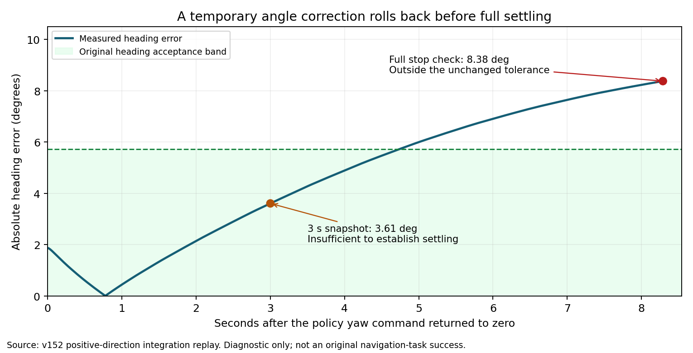

# Go2 小角度转向回摆：完整停稳复核与官方策略路线

更新：2026-10-30。**问题尚未完全解决。v147 T04完整通过，v149 T05仍失败，二者不是同版统一成功。v152有界短转候选已经物理验证失败并被拒绝，v153/v154补充诊断已结束。** 当前生产控制器仍是`fbcaa14`，没有采用新的policy或启动新的原始场景运行。

## 原始任务结果

v149 T05使用子导航生命周期修复后，实际向东推动B07 **0.122830 m**，随后对准耗尽恢复次数，以`push_aside:retry_limit:heading_drift_during_alignment`失败。20692主步，目标误差1.702135 m，全物理步最大倾角23.429689°。该版本T04按前置门控未启动。

五路视频各4194帧、25 fps、167.76秒，源码、解码和本地哈希有效，任务和实际通路穿越检查均未通过。Windows总览：`E:/inter-nav-results/go2-online-smooth-20261027/recognition-skill-v149-t05-ground-truth-try1/T05/video/combined.mp4`。旧v147 T04的推箱、在线确认、实际穿越和最终0.212162 m停稳结果见[完整记录](go2_original_t04_v147.md)。

## 定位结果与边界

把真实T05首次微调前的8583个控制周期、13732个物理步重放到平地，同一模型、policy、1 cm地面和GPU物理下，位置、航向和电机目标逐步一致。这个前缀没有非地面接触。随后再次出现转向后回摆，说明剩余微调问题可以在不加载导航地图和箱子的情况下复现。

证据指向当前policy与部署组合的低速转向、启停响应。不能据此断言所有踉跄均由权重引起，也不能声称换任意policy就能解决接触任务。当前权重是第三方rough7850，不是宇树出厂策略。已有生命周期和停稳切换等上层问题分别修复；原始T05依然没有通过。

v150基线停稳后误差8.294°；取消按角速度预测提前制动后仍差7.798°。这个改动已被拒绝。

## 纠正此前3秒标定结论

v151的±0.55/±0.60 rad/s短脉冲，在零指令后3秒看起来进入误差范围。但3秒终点没有覆盖原控制器的完整停稳过程，不能用于选择生产参数。

v152候选`699fcb2f059ee99581565057e0e76e8577a3ff0c`虽通过743项回归，完整物理状态机仍超时。正向0.55 rad/s保持0.04秒后，3秒时误差约3.61°；到原停稳判据实际评估的8.29秒时，误差回到8.38°，超过0.10 rad（5.73°）门限。候选单独保留在`codex/go2-yaw-step-v152-20261030`，**未合入、未采用**。

另检查了“已在误差带内却被预测项重新触发纠偏”的猜测，符合该条件的记录为0，没有据此修改代码。

v153沿用原1.2秒停稳窗口及0.015 rad漂移检查：正向0.55/0.04、0.60/0.04、0.60/0.15都失败，停稳误差约8°；反向0.60/0.04及0.60/0.15通过诊断。该结果只说明这个回放起始状态存在方向差异，不能替代完整导航验收。

## v154：更强或更长脉冲仍不合格

四个正向案例全部结束并失败。位移列是接管后每条控制记录中的最大偏移，包含动作过程，不只检查终点；位置记录没有宣称覆盖每个物理子步。倾角来自全物理步检查。

| 案例 | 最终朝向误差 | 过程最大偏移 | 微调阶段最大倾角 | 结论 |
|---|---:|---:|---:|---|
| pulse060_hold040_positive | 15.774° | 0.6490 m | 13.958° | 未通过 |
| pulse065_hold004_positive | 8.402° | 0.0224 m | 4.859° | 未通过 |
| pulse065_hold015_positive | 7.989° | 0.0324 m | 4.774° | 未通过 |
| pulse065_hold040_positive | 14.456° | 0.4495 m | 15.530° | 未通过 |

短脉冲仍回摆；两个0.40秒案例的过程偏移分别约0.45 m和0.65 m，超出原0.25 m微调预算，不能作为近箱方案。0.60/0.40还在20秒内未达到原完整停稳评估。没有通过调大门限、延长重试或忽略过程超界来接受这些结果。

## 替换policy的建议

建议将替代策略对照作为下一条工作路线，避免继续把单一脉冲的幅值和时长标定当作充分解决方案。[宇树官方来源复核](go2_official_policy_review.md)确认，所查RL Gym/RL Lab版本均有Go2训练配置，但完整树和Release没有附带Go2预训练权重。RL Lab的Go2部署配置指向本地训练输出。官方出厂运动控制器也没有随这两个仓库提供可直接加载到本仿真的模型。

官方RL Lab可以作为训练基线；其45维Actor输入与当前235维输入不同，动作顺序、观测缩放、执行器曲线须按导出配置适配。当前Isaac Sim4.2.0.2环境与官方主线README的5.1/Isaac Lab2.3也不同，需隔离训练环境。**尚未开始官方策略训练或权重替换**，配置中的站立和足滑奖励不代表已验证推箱更稳。

替代候选先在其匹配模型上检查直行启停、左右侧移、双向小角度转向的完整停稳和受力接触，再迁入相同任务物理条件；同一条速度历史用于输入响应对照，新策略不会被要求复现旧策略的物理轨迹。短测合格后，从原始坐标先跑T05，再跑同版T04。仍需实际侧推、新观测清路、真实穿越、停稳误差小于0.25 m、全程倾角小于30°、启动小于15°及五路25 fps视频。

短测仍为8 GiB硬上限、零swap、40 GiB主机准入，原场景24 GiB/零swap/56 GiB准入，均使用同一串行锁。诊断及原任务目前均已结束，没有新的仿真进程在后台测试。

完整[诊断证据](data/go2_yaw_step_diagnostics_v152.json)、[v154全轨迹审计](data/go2_yaw_trace_audit_v154.json)、[官方核查清单](data/go2_official_policy_recheck_v154.json)。服务器诊断目录均位于`/data20t/embodied/zkj/inter-nav-results/go2-online-smooth-20261027`。v150–v153本地归档为`interface-v59/yaw-response-v150-v153-20261030.tar.gz`，SHA256：`b6368fdd29b14e30779f0ea77e61a2088ea0c435f9a34aa799c47e9883c5f3ee`。

v154完整控制轨迹和审计归档为`interface-v59/yaw-response-v154-20261030.tar.gz`，共58个文件，SHA256：`e757d6145028811078019d88c764ab88635225d8db2c67f9a73faa59faeabe96`。
